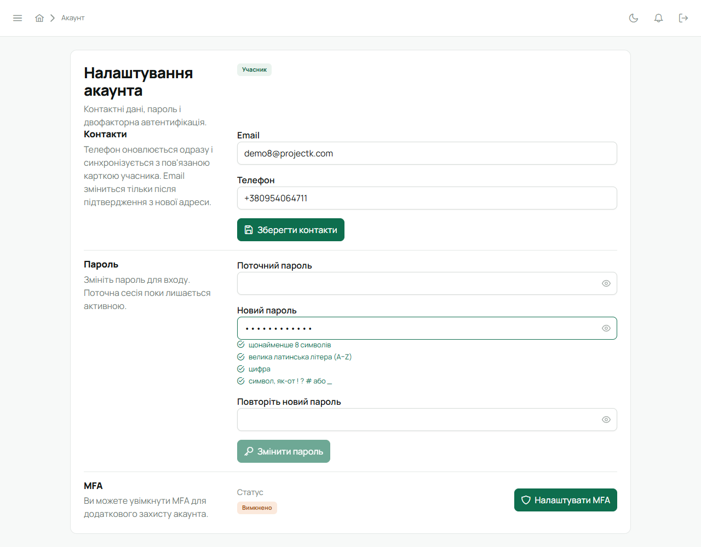

Бічне меню → **«Налаштування акаунта»**. На телефоні — «Меню» → «Налаштування акаунта».

## Контакти

**Email** і **Телефон**. Телефон зберігається одразу й зʼявляється на твоїй картці учасника.
Новий email запитує поточний пароль і застосовується лише після підтвердження листом на нову
адресу — до того лишається старий. Натисни **«Зберегти контакти»**.

Імʼя, дату народження та інше змінюють на картці учасника («Мій профіль» → «Редагувати»).

## Пароль

**Поточний пароль** → **Новий пароль** → **Повторіть новий пароль** → **«Змінити пароль»**.

Новий пароль має:

- щонайменше 8 символів;
- велику латинську літеру (A–Z);
- цифру;
- символ, як-от `! ? #` або `_`.

Під полем видно, які правила вже виконано. Зміна пароля завершує входи на всіх пристроях: на інших
доведеться увійти знову з новим паролем, а тут ти лишаєшся до кінця поточної сесії. Довірені
пристрої для двофакторного входу теж скидаються — код запитають знову.

## Двофакторний вхід (MFA)

Для **Звʼязкового й адміністратора** він обовʼязковий (якщо так налаштовано на сервері), для решти —
за бажанням. Покроково — [Увімкнути двофакторний вхід](/user/howto/enable-mfa/).

- **Увімкнути** — **«Налаштувати MFA»**: QR-код → застосунок-автентифікатор → шестизначний код →
  збережи резервні коди.
- **Довірений пристрій** — після вдалого коду цей браузер запамʼятовується на 7 днів, і протягом
  тижня код не питають. Інший пристрій — з кодом.
- **Резервні коди** — кожен діє один раз. **«Оновити резервні коди»** видає новий набір і скасовує
  старий (потрібен поточний пароль).
- **Вимкнути** — **«Вимкнути MFA»** з поточним паролем. Звʼязковий і адміністратор цієї кнопки не
  бачать: вони можуть лише **«Скинути MFA»** й одразу налаштувати заново.

## Кілька акаунтів

Якщо в тебе кілька акаунтів (наприклад, свій і адмінський), тримай їх на одному пристрої й
перемикайся без пароля — [Перемкнути акаунт](/user/howto/switch-account/).

## Вихід

Кнопка виходу — праворуч на панелі вгорі; на телефоні — «Меню» → **«Вийти»**. Вихід завершує вхід
на цьому пристрої **для всіх збережених на ньому акаунтів**. Входи на інших пристроях лишаються.
Зміна пароля або скидання MFA завершує всі входи на всіх пристроях.

## Втратив доступ

- **Забув пароль** — «Забули пароль?» на сторінці входу, лист прийде на пошту акаунта. Якщо акаунт
  ще не активований, так само прийде нове запрошення.
- **Загубив телефон з автентифікатором** — увійди резервним кодом: на сторінці коду натисни
  **«Ввести резервний код»**. Потім одразу налаштуй MFA заново з новим телефоном.
- **Немає ні телефона, ні кодів** — звернися до адміністратора системи.

## Тема

Перемикач світлої й темної теми — місяць / сонце на панелі вгорі. На телефоні — «Меню» →
**«Вигляд»**. Вибір зберігається на пристрої.
