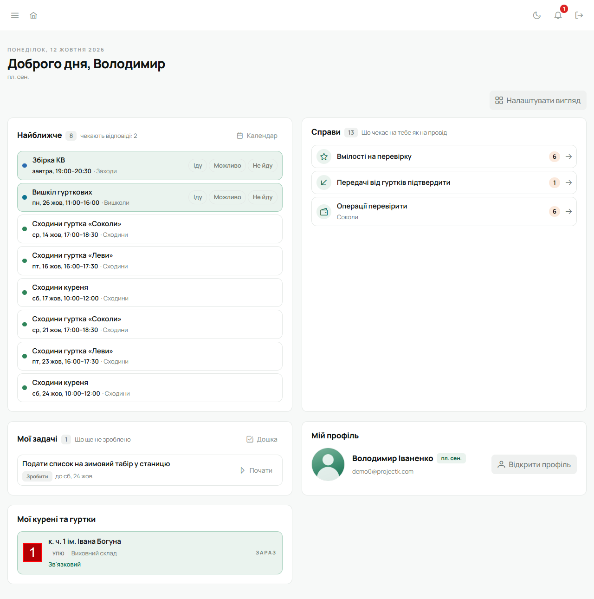
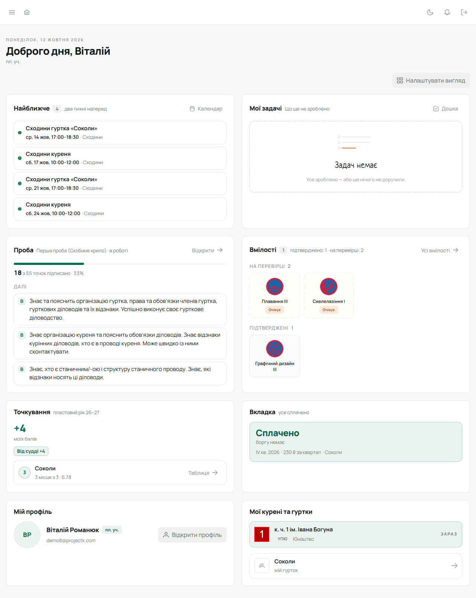
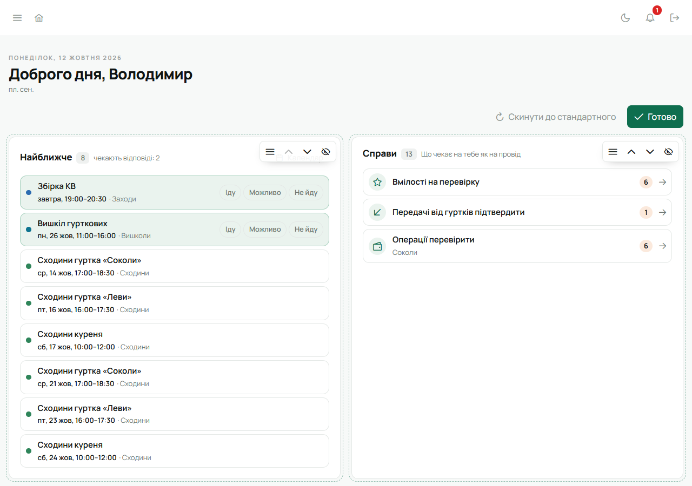

Після входу відкривається **головна** — усе, що стосується саме тебе. Повернутися на головну можна з будь-якого місця — пунктом
«Головна» в сайдбарі або кліком по банеру «Лілейка» над ним.

Угорі — привітання, сьогоднішня дата, твій ступінь і гурток. Нижче — плитки.

## Плитки

Кожен бачить лише ті плитки, що його стосуються. Юнак не побачить «Справ», а впорядник без юнацького
членства — проби й вмілостей.

| Плитка | Для кого | Що показує |
|---|---|---|
| **Найближче** | усім | події на два тижні вперед |
| **Справи** | проводу | що чекає на тебе як на діловода |
| **Мої задачі** | усім | невиконані задачі, де крок за тобою |
| **Проба** | юнакам УПЮ | поточна проба і наступні точки |
| **Вмілості** | юнакам УПЮ | вмілості на перевірці, у роботі й підтверджені |
| **Точкування** | юнакам у гуртку | свої бали за пластовий рік і місце гуртка |
| **Вкладка** | у кого є рахунок | сплачено, борг або надлишок |
| **Мій профіль** | усім | фото, ступінь, кнопка «Відкрити профіль» |
| **Мої курені та гуртки** | усім | твій курінь, роль у ньому і твій гурток |

### Найближче

Сходини, заходи й табори, що стосуються тебе, на два тижні вперед. Відповісти **«Іду»**,
**«Можливо»** чи **«Не йду»** можна прямо в рядку, не відкриваючи календаря. Події, що чекають на
твою відповідь, стоять першими й підсвічені. Відповідь на сходини, що повторюються, стосується лише
цієї дати: на наступні сходини відповідаєш окремо. Кнопка «Календар» відкриває
[календар](/user/features/calendar-and-tasks/) куреня.

### Мої задачі

Лише задачі, де наступний крок за тобою: призначені тобі, твоя частина задачі гуртка «кожному
окремо», задачі, які закриває будь-хто з гуртка, і ті, які закриває провід, коли ти в ньому.
Задачі, які ти поставив іншим, і задачі гуртка, які закриває провід, сюди не потрапляють — їх
видно на дошці. Задачу можна
**«Почати»**, а потім позначити **«Зроблено»**. Виконана зникає з плитки. Прострочений термін видно
червоним. Кнопка «Дошка» відкриває всі задачі куреня.

### Справи

Плитка для проводу: що зараз чекає саме на тебе. Рядок показує, скільки справ, і веде туди, де їх
роблять.

- **Вмілості на перевірку** — юнаки твоїх гуртків подали вмілості. Веде на
  [модерацію вмілостей](/user/features/probes-and-badges/).
- **Передачі від гуртків підтвердити** — для скарбника куреня. Гуртки передали гроші, а ти ще не
  позначив «Отримано».
- **Операції перевірити** — записи в касі гуртка чи куреня, яких ніхто не позначив «Перевірено».
- **Відмітити присутність** — сходини чи захід за останні два тижні, за які дають бали, а
  присутності не відмічено ні в кого. Веде одразу на аркуш присутності цієї події.

Кожна справа зʼявляється лише в того, хто має право її зробити: скарбник гуртка бачить свою касу,
суддя — присутність свого гуртка, Звʼязковий — усе в курені. Коли робити нічого, плитка каже «Усе
зроблено».

### Проба і Вмілості

**Проба** показує пробу, над якою ти працюєш, скільки точок уже підписано, і три наступні точки з
номером розділу. Кнопка «Відкрити» веде на саму пробу. Коли всі проби складено, плитка про це й
скаже.

**Вмілості** розкладено на три полиці: «На перевірці», «У роботі» й «Підтверджені». Кнопка «Усі
вмілості» веде на твою картку. Як подати вмілість — на сторінці
[Проби й вмілості](/user/features/probes-and-badges/).

### Точкування

Велике число — твої бали за поточний пластовий рік. Під ним видно, з чого вони склались:
присутність, бали від судді, вмілості, проби, вкладка, перестороги. Нижче — твій гурток, його місце
серед гуртків куреня і кнопка до таблиці. Докладно — на сторінці
[Точкування](/user/features/score/).

### Вкладка

Сплачено — зеленим, борг — червоним, надлишок — з плюсом. Під сумою — поточний квартал, ставка за
нього й гурток. Борг віддають скарбникові гуртка. Докладно — на сторінці
[Вкладка](/user/features/dues/).

### Мої курені та гуртки

Твій курінь, роль у ньому і твій гурток. Клік по гуртку відкриває його сторінку.

## Свій вигляд

Кнопка **«Налаштувати вигляд»** вмикає режим налаштування:

- плитки можна перетягувати або пересувати стрілками вгору й униз;
- непотрібну плитку можна сховати кнопкою з перекресленим оком;
- сховані плитки видно вгорі як «Приховано: …», клік повертає плитку на її місце;
- «Скинути до стандартного» повертає порядок за замовчуванням;
- «Готово» зберігає.

Розклад запамʼятовується для твого акаунта, тож на телефоні й компʼютері він однаковий.

## На телефоні

Вкладка **«Головна»** показує ті самі плитки в тому самому порядку, але лише для читання: порядок
змінюють у вебі. «Мій профіль» на телефоні живе в «Меню». Детально —
[Лілейка на телефоні](/user/features/mobile-app/).
