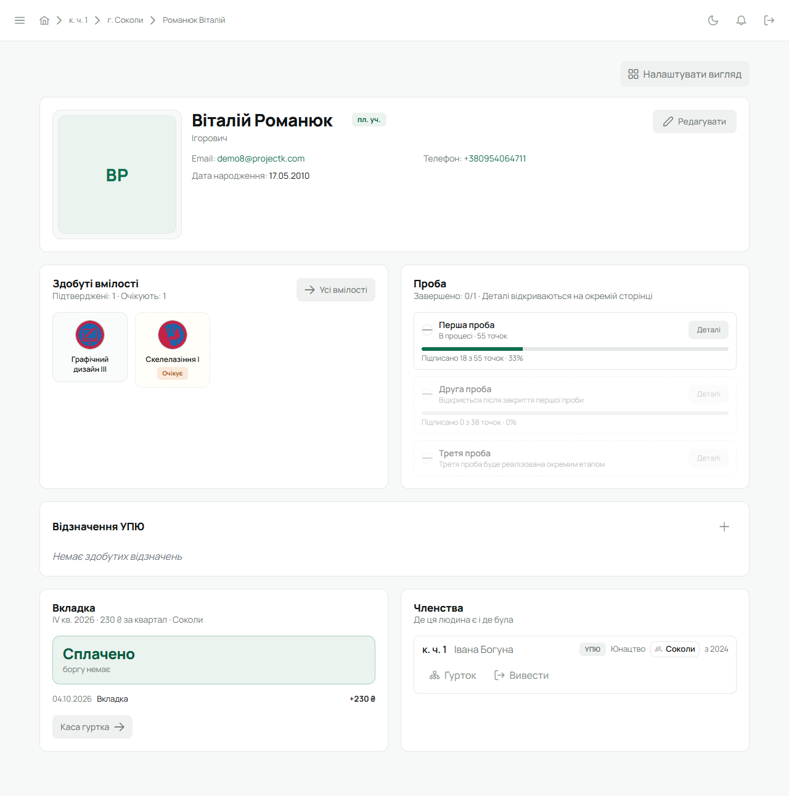
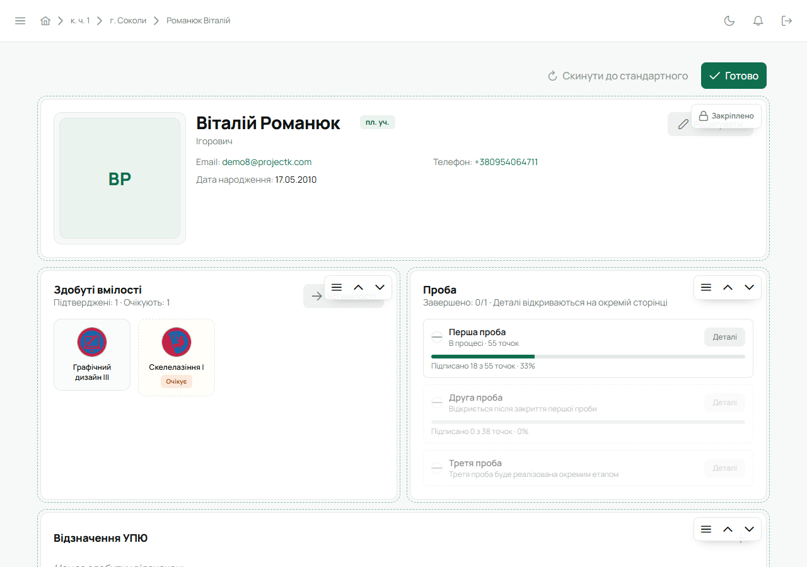
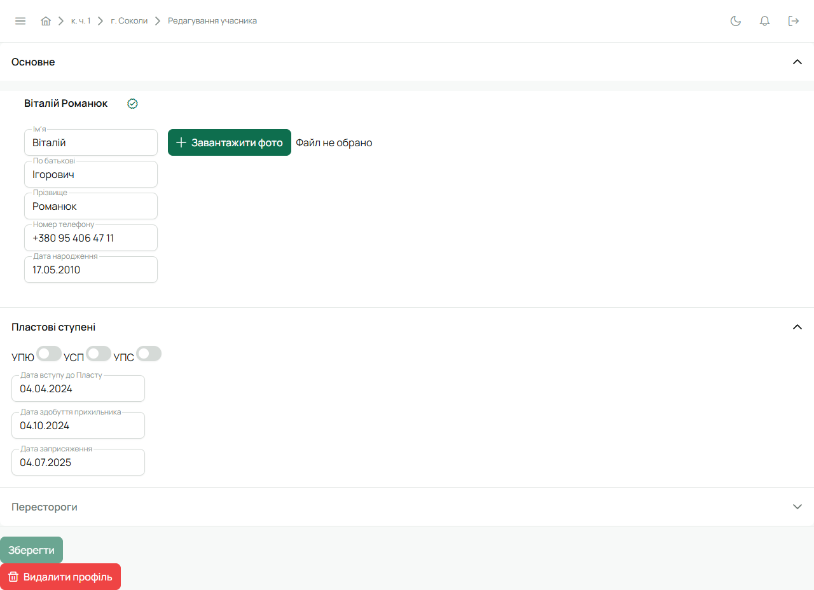

Картка відкривається зі списку учасників куреня чи гуртка, з реєстру або як «Мій профіль».
Це джерело правди про людину: усе, що про неї знає Лілейка, зібране тут.

## Шапка

- **Фото** або ініціали, якщо фото немає.
- **Імʼя**, по батькові, **ступінь** (тег поруч з імʼям).
- **Email, телефон, дата народження.**
- **Верифікація** — значок біля імені й рядок «Верифіковано», якщо в курені увімкнена перевірка
  профілів. Див. [нижче](#верифікація).
- **Перестороги** — три крапки біля імені; наведи, щоб побачити рівень і скільки днів лишилось.
  Див. [Пересторога](/user/howto/warning/).

## Плитки

| Плитка | Що в ній |
|---|---|
| **Здобуті вмілості** | підтверджені й ті, що на розгляді; «Усі вмілості» — повний перелік і «Додати вмілість» |
| **Проба** | скільки точок першої та другої проби підписано; «Деталі» — сторінка проби з точками |
| **Відзначення УПЮ** | відзначення з рівнем і датою; «+» — додати |
| **Впорядництво** | ролі людини в КВ і гуртки, які вона веде (лише якщо такі є) |
| **Вкладка** | баланс людини: сплачено, борг чи надлишок, останні внески; «Каса гуртка» для скарбника |
| **Членства** | де людина є зараз і де була «Раніше»; «Гурток» і «Вивести» для Звʼязкового |

Вмілості, проба й відзначення показуються лише юнацтву УПЮ — див. [УПЮ, УСП, УПС](/user/features/branches/).
Як працюють проба й вмілості — [Проби й вмілості](/user/features/probes-and-badges/), членства —
[Перевести, вивести, повернути](/user/howto/membership/).

## Налаштувати вигляд

Кнопка **«Налаштувати вигляд»** над плитками: перетягни плитки в потрібному порядку або сховай
непотрібні. **«Скинути до стандартного»** повертає як було, **«Готово»** — зберегти. Вигляд
запамʼятовується для твого акаунта й однаковий для всіх карток, які ти відкриваєш.

## Редагування

Кнопка **«Редагувати»** в шапці. Бачать її адміністратор, Звʼязковий і впорядник гуртка цієї людини.

- **Імʼя, по батькові, прізвище, дата народження.**
- **Email і телефон.** Якщо в людини вже є активний акаунт, контакти змінює лише вона сама — у
  [Налаштуваннях акаунта](/user/account/); картка підтягує зміну. Поки акаунт не активовано,
  пошту можна виправити тут, і запрошення піде на нову адресу.
- **Фото** — «Завантажити фото», обріж і збережи; «Очистити фото» прибирає його.
- **Ступені** — дата здобуття кожного ступеня. Останній записаний — поточний.
- **Перестороги** — видати чи скасувати: [Пересторога](/user/howto/warning/).
- **Видалити профіль** — внизу форми. Це не те саме, що вивести з куреня:
  [Видалити профіль](/user/howto/membership/#видалити-профіль).

## Верифікація

Якщо в [налаштуваннях куреня](/user/roles/leader/#6-налаштування-куреня) увімкнена верифікація
профілів, той, хто перевірив дані людини, натискає кнопку верифікації вгорі форми редагування.
Якщо потім зміниться щось суттєве (імʼя, дата народження, ступінь, контакти), позначка стане
«застарілою», і профіль варто перевірити знову. Покроково — [Верифікувати профіль](/user/howto/verify-profile/).

## На телефоні

Картку відкриває дотик до людини в будь-якому списку, свою — «Меню» → профіль угорі. Там ті самі
дані й плитки і **«Редагувати»** для тих, хто може змінювати картку.
