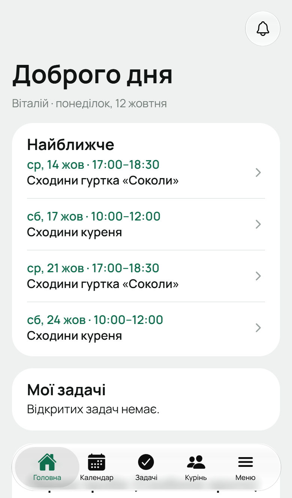
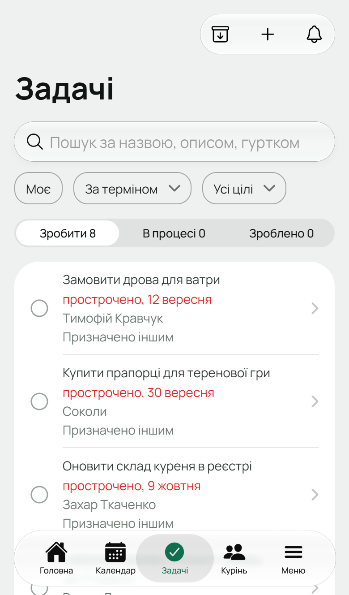
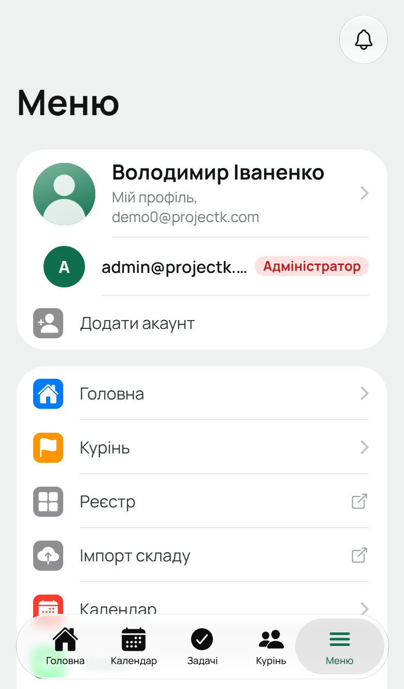
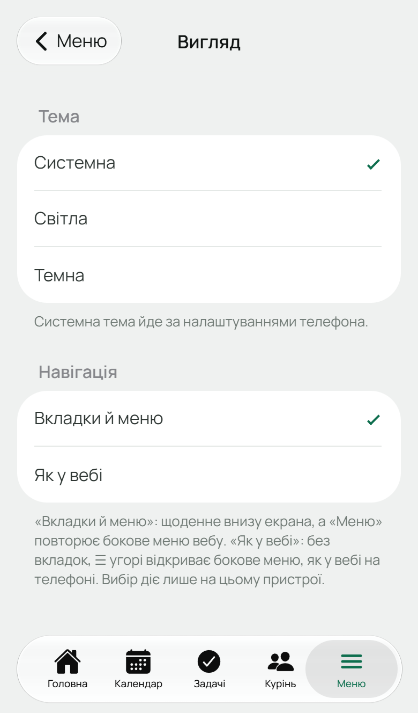

На телефоні Лілейка відкривається як мобільна версія — окремий застосунок під адресою `/m/`
на тому самому сайті. Вхід той самий, що й у вебі: якщо ти вже увійшов на сайті, на телефоні
вдруге входити не треба. Її можна поставити на екран телефона як звичайний застосунок —
про це [окрема інструкція](/user/howto/install-app/).

Звичайна адреса Лілейки на телефоні сама переходить у мобільну версію, на той самий екран.

## Вкладки

Унизу екрана пʼять вкладок:

| Вкладка | Що там |
|---|---|
| **Головна** | те саме, що на [головній у вебі](/user/features/dashboard/): справи проводу, найближчі події з кнопками «Іду / Можливо / Не йду», твої задачі, проба, вмілості, бали й вкладка |
| **Календар** | події куреня: місяць, тиждень, день або список; **+** вгорі — нова подія (якщо ти в проводі) |
| **Задачі** | дошка задач з колонками-вкладками «Зробити / В процесі / Зроблено», фільтри «Моє», сортування й ціль; архів і **+** вгорі |
| **Курінь** | «Огляд» — гуртки, точкування, КВ і провід куреня; «Учасники» — список людей куреня з пошуком і ролями. Вкладка гуртка й куреня — у «Меню» |
| **Меню** | твій профіль, решта пунктів бічного меню вебу, вигляд, сповіщення, вихід |

Порядок і видимість плиток на Головній телефон бере з вебу: що ти сховав чи переставив кнопкою
«Налаштувати вигляд» на головній у вебі, так буде й тут. На самому телефоні цей порядок не
змінюється.

## Задачі на телефоні

- **Перенести задачу в іншу колонку:** торкнись кружечка ліворуч від назви й обери колонку. Або
  потягни рядок задачі праворуч — зʼявляться кнопки колонок.
- **Редагувати, в архів, видалити:** потягни рядок ліворуч → **«Ще»** (там «Редагувати» і «В архів»)
  або **«Видалити»**.
- **Деталі задачі:** торкнись назви.
- **Архів:** значок архіву вгорі праворуч. З архіву задачу можна повернути.

Що саме ти можеш робити із задачею, вирішує твоя роль, як і у вебі —
див. [Календар і задачі](/user/features/calendar-and-tasks/).

## Меню

Вгорі — **твій профіль**: торкнись його, щоб відкрити свою картку. Під ним — **інші акаунти**, у
які ти входив на цьому телефоні, і **«Додати акаунт»** (див.
[Перемкнути акаунт](/user/howto/switch-account/)).

Далі — ті самі пункти, що в бічному меню вебу, у тому самому порядку й з тими самими правами.
Пункти зі значком ↗ праворуч відкривають сторінку вебу в браузері, бо в мобільній версії свого
екрана для них немає:

- **Реєстр**, **Імпорт складу**, **Налаштування куреня**;
- для адміністратора — **Адміністрація**, **Користувачі**, **Системні налаштування** (а от
  **«Заявки»** мають свій екран і на телефоні);
- **Довідка** — ця документація.

Нижче — те, що є лише на телефоні:

- **Вигляд** — тема й навігація (див. нижче);
- **Сповіщення на телефон** — перемикач push-сповіщень (див. нижче);
- **Мої курені** — якщо ти в кількох куренях: тут видно всі твої курені й гуртки і можна перейти
  в інший курінь;
- **Конфіденційність** — що Лілейка зберігає про тебе;
- **Повна версія** — відкрити звичайний сайт замість мобільної версії. Телефон запамʼятає вибір;
  повернутися можна посиланням **«Мобільна версія»** вгорі сайту.

У самому низу — **«Вийти»**. Якщо на телефоні збережено кілька акаунтів, кнопка виходить з усіх.

## Вигляд

«Меню» → **«Вигляд»**:

- **Тема** — Системна (як на телефоні), Світла або Темна.
- **Навігація**:
  - **«Вкладки й меню»** (типово) — пʼять вкладок унизу, як описано вище;
  - **«Як у вебі»** — без вкладок: кнопка ☰ угорі відкриває бокове меню, як у вебі на телефоні.

Вибір діє лише на цьому телефоні.

## Сповіщення на телефон

Дзвіночок угорі праворуч відкриває [сповіщення](/user/features/notifications/) — ті самі, що у
вебі. Щоб вони приходили на телефон навіть коли Лілейка закрита, увімкни «Меню» →
**«Сповіщення на телефон»** і дозволь сповіщення, коли телефон спитає.

- **Android** — працює і в браузері, і у встановленому застосунку.
- **iPhone** — лише в Лілейці, встановленій на початковий екран, і з iOS 16.4 або новішою. У
  Safari перемикача не буде, натомість зʼявиться підказка, як це зробити.

Якщо перемикача немає взагалі — сервер Лілейки не налаштований на push-сповіщення (так буває на
власних серверах куренів).

## Чого на телефоні немає

Усе щоденне — є. Кілька рідкісних речей лишились лише у вебі й відкриваються через «Меню» в
браузері: реєстр, імпорт складу, налаштування куреня, адмінка. «Точкування КВ» і налаштування
точкування теж лише у вебі.
