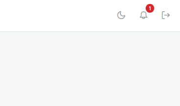
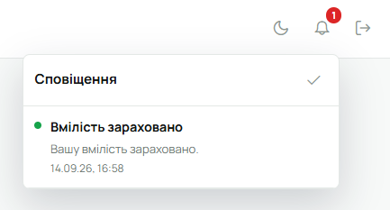

Усе, що стосується тебе, приходить у **дзвіночок** у верхній панелі. Число на ньому — скільки
непрочитаного (більше сотні показується як «99+»).

Натисни дзвіночок — відкриється список **«Сповіщення»**. Непрочитані позначені зеленою крапкою.
Клік по сповіщенню позначає його прочитаним і веде на сторінку, про яку воно: картку, пробу,
задачу чи подію. Галочка вгорі списку — **«Позначити всі як прочитані»**.

Прочитані сповіщення зникають через 7 днів, непрочитані — через 30.

## Що приходить

- **Вмілості:** твою вмілість зараховано чи відхилено; для впорядника — юнак подав вмілість на
  перевірку.
- **Відзначення:** твоє відзначення затверджено чи ні; для впорядника — відзначення подано на
  розгляд.
- **Перестороги:** тобі призначили пересторогу.
- **Верифікація:** твої профільні дані підтверджено; для проводу — дані верифікованого юнака
  змінилися й їх треба перевірити знову.
- **Календар і задачі:** тобі призначили подію чи задачу, її змінили, видалили або змінили
  статус задачі.
- **Адміністратору:** нова заявка куреня на розгляд.

Про підпис точки проби і про зміну ролі в курені сповіщення не приходить.

## На телефоні

У мобільній версії дзвіночок угорі відкриває окремий екран сповіщень з тією самою кнопкою
«Позначити всі як прочитані».

Сповіщення можуть приходити й на сам телефон, навіть коли Лілейка закрита: «Меню» →
**«Сповіщення на телефон»**. На iPhone це працює лише в Лілейці, встановленій на початковий
екран (iOS 16.4 і новіші) — див. [Встановити Лілейку на телефон](/user/howto/install-app/). Якщо
пункту в «Меню» немає, сервер сповіщень на телефон не надсилає.

## Що приходить листом

На пошту йдуть лише запрошення в акаунт, відновлення пароля, підтвердження нової пошти і заявки
для адміністратора. Решта живе в застосунку, тож дзвіночок варто перевіряти.
