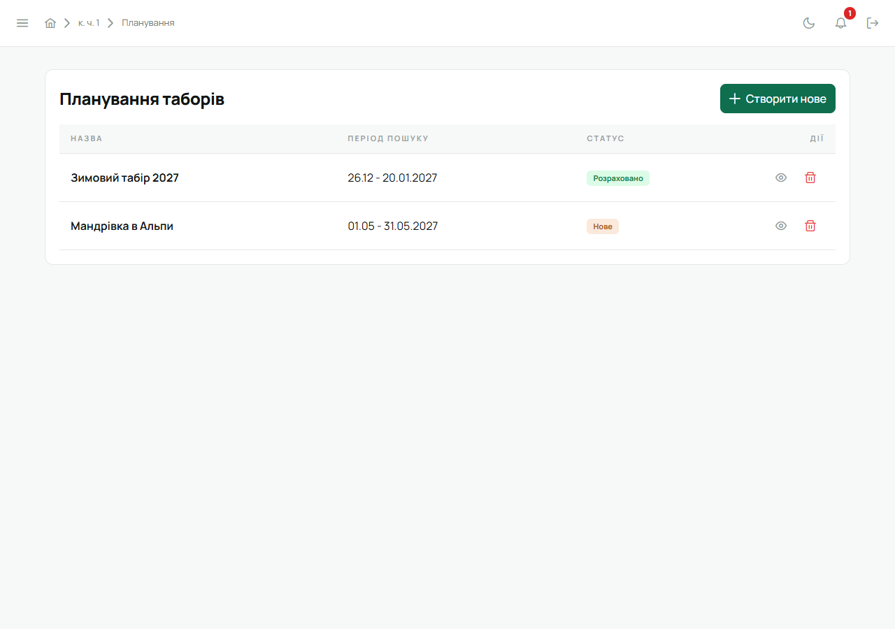
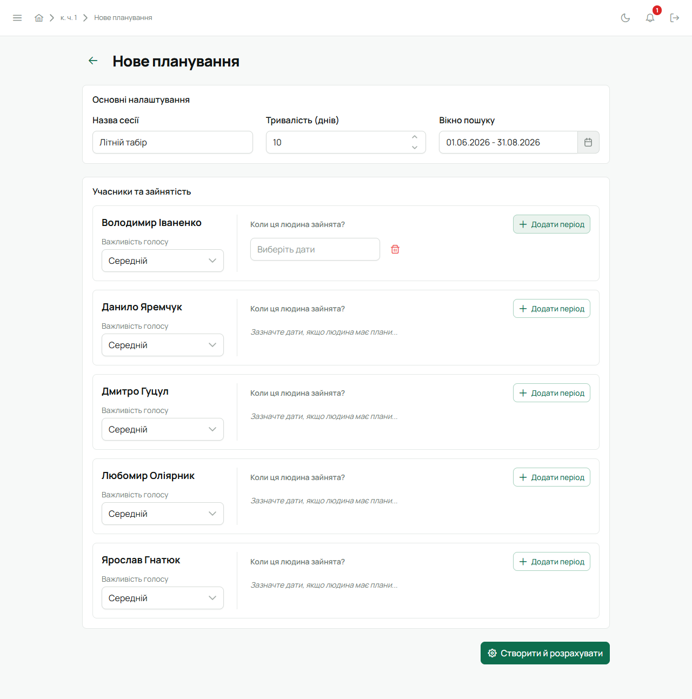
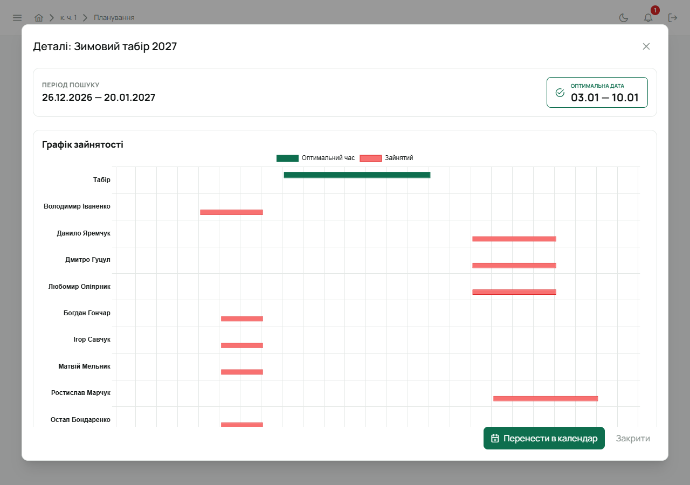

Бічне меню → **«Планування»**. Відповідає на одне питання: коли провести табір, щоб зібрати
якнайбільше КВ. Бачить планування кожен у курені, створює — будь-хто з проводу: Звʼязковий,
впорядники й інструктори, курінний і гуртковий провід.

## Створити планування

1. Натисни **«Створити нове»** (або **«Створити планування»**, поки список порожній).
2. **Основні налаштування:** **«Назва сесії»**, **«Тривалість (днів)»** і **«Вікно пошуку»** —
   період, у якому шукаємо дату.
3. **Учасники та зайнятість:** Лілейка підтягує всіх із КВ куреня. Для кожного:
   - **«Важливість голосу»** — низька, середня чи висока: чия присутність важливіша;
   - **«Коли ця людина зайнята?»** — **«Додати період»** і обери дати. Періодів може бути кілька,
     кошик прибирає зайвий.
4. Натисни **«Створити й розрахувати»**.

Лілейка перебирає всі варіанти у вікні пошуку і бере дату з найменшою «ціною» конфліктів: чим
важливіша людина, яка не зможе, тим дорожчий варіант.

## Подивитися результат

У списку біля планування натисни око **«Переглянути графік»**. Угорі — **«Оптимальна дата»**,
нижче — графік зайнятості: зелена смуга — табір, червоні — хто коли зайнятий. Наведи на смугу,
щоб побачити точні дати.

**«Перенести в календар»** створює подію на весь курінь з назвою планування на оптимальні дати.
Група подій у неї не ставиться — признач її сам, відкривши подію в календарі.

Збережене планування не змінюється й не перераховується: якщо чиясь зайнятість змінилась, створи
нове, а старе видали — кошик **«Видалити планування»** в рядку списку. Видалити може автор планування
і Звʼязковий; подія, вже перенесена з нього в календар, лишається.

## На телефоні

«Меню» → **«Планування»** (або календар → «Планування таборів»): той самий список, графік і
форма; видаляють там свайпом по рядку.
