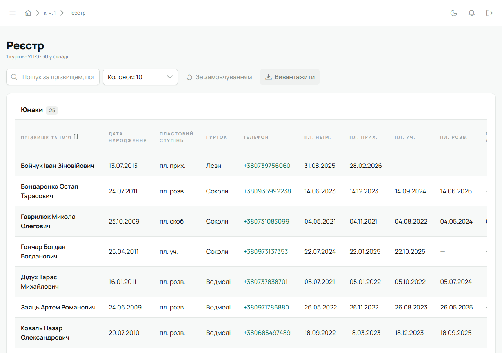
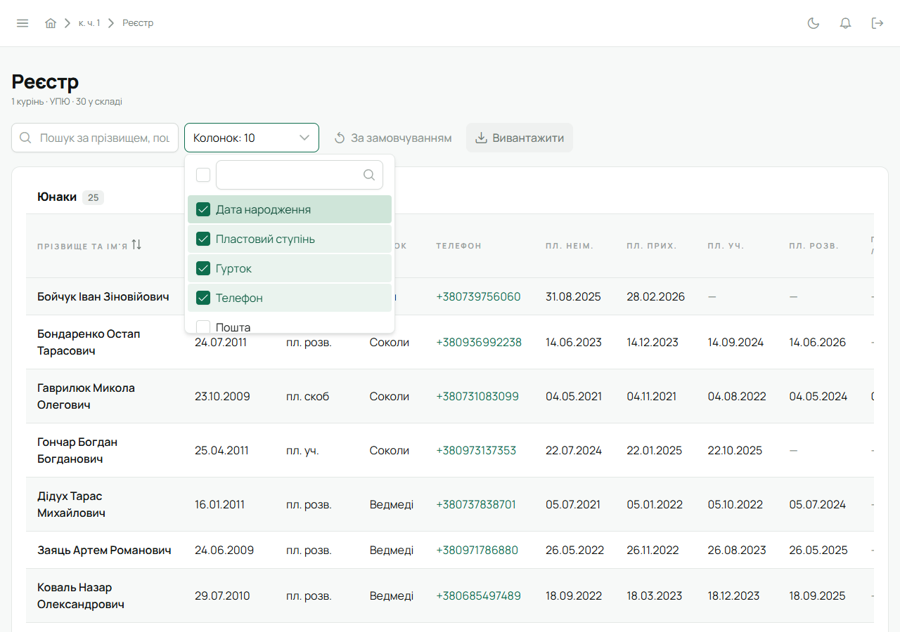

Бічне меню → **«Реєстр»**. Його бачать впорядники, Звʼязковий і адміністратор. Під заголовком —
число куреня або «Підготовчий курінь», якщо числа ще немає.

Реєстр має дві таблиці: **Юнаки** і **Впорядники**. Впорядник тут — той, хто має роль у КВ або
закріплений за гуртком; у його таблиці замість власного гуртка — **«Гурток (закріплення)»**.
Клік по рядку відкриває [картку учасника](/user/features/member-card/).

## Колонки

Типово видно дату народження, пластовий ступінь, гурток, телефон і дати ступенів УПЮ. Інші — пошта, решта дат ступенів — вмикаються в списку **«Колонки»**.
**«За замовчуванням»** повертає типовий набір. Вибір запамʼятовується в цьому браузері для
кожного куреня окремо.

## Пошук і сортування

Поле пошуку шукає за прізвищем, поштою і гуртком. Сортувати таблицю можна за прізвищем та імʼям —
клік на заголовок колонки.

## Вивантажити

Кнопка **«Вивантажити»** зберігає реєстр у таблицю Excel. Для повного звіту з гуртками, КВ і
проводом є [PDF-звіт куреня](/user/roles/leader/#7-pdf-звіт).

## Колишні

Людина, яка вийшла з куреня, не зникає: її картка лишається з історією. Внизу реєстру розгорни
**«Колишні»** — там видно, коли людина була в курені й коли вибула. **«Повернути»** відкриває
членство наново. Детально — [Повернути колишнього](/user/howto/membership/#повернути-колишнього).

## Чисельність за ступенями

Остання таблиця — скільки людей зараз на кожному ступені. Зручно для звітів станиці.

## Хто може змінювати

Редагувати картки — впорядник у своєму гуртку, Звʼязковий у всьому курені. Сам реєстр лише
показує людей: перевести, вивести чи повернути — [Перевести, вивести, повернути](/user/howto/membership/).

## На телефоні

У мобільній версії реєстру немає: пункт «Реєстр» відкриває повну версію в браузері. Списки
учасників куреня й гуртків є на вкладці «Курінь».
