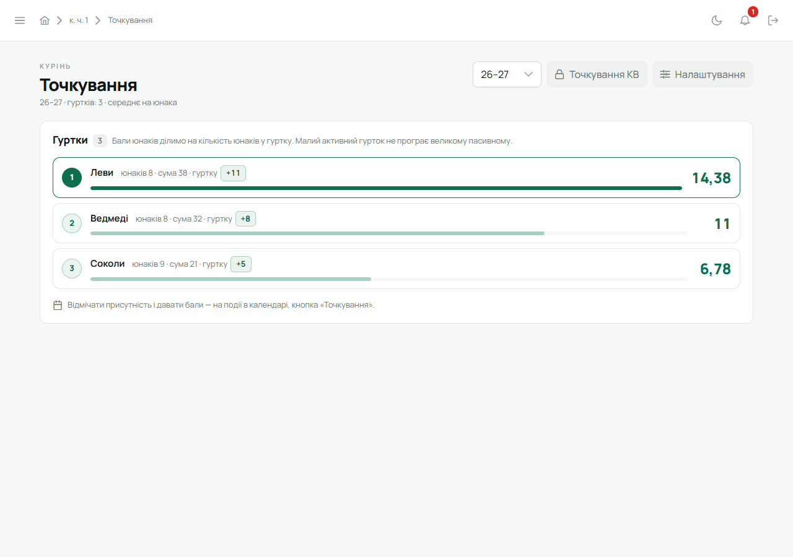
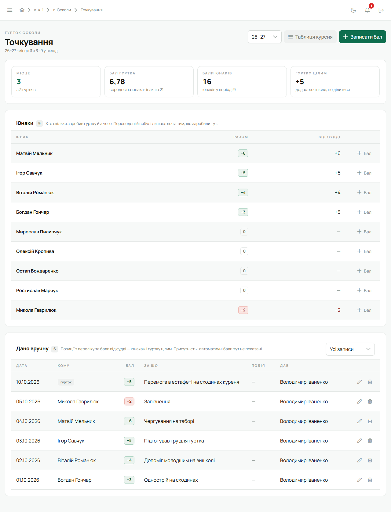
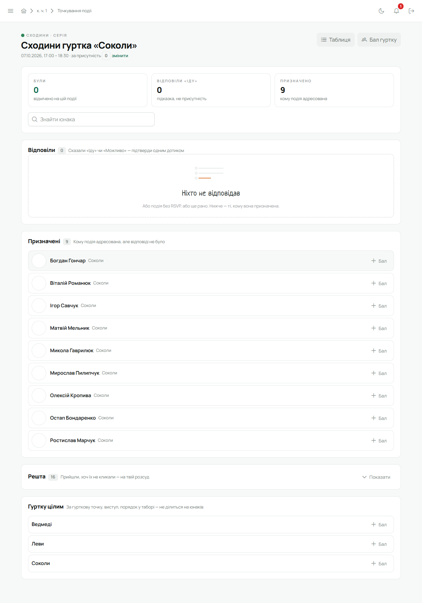
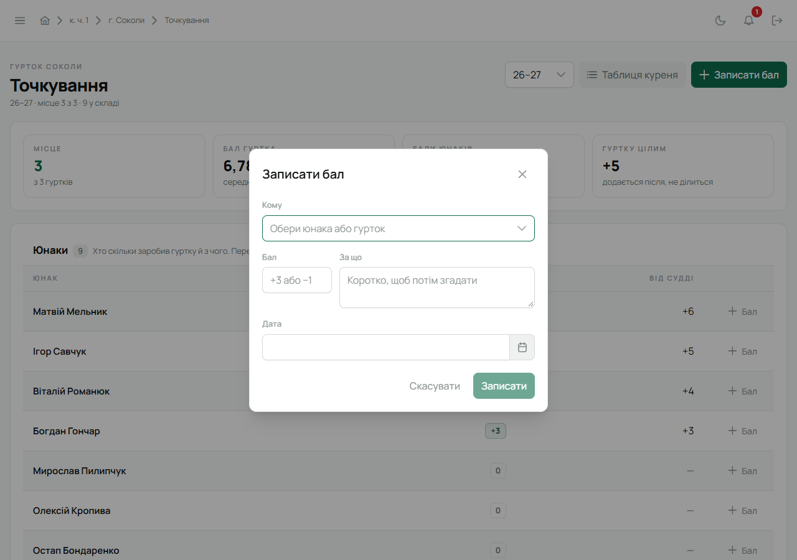
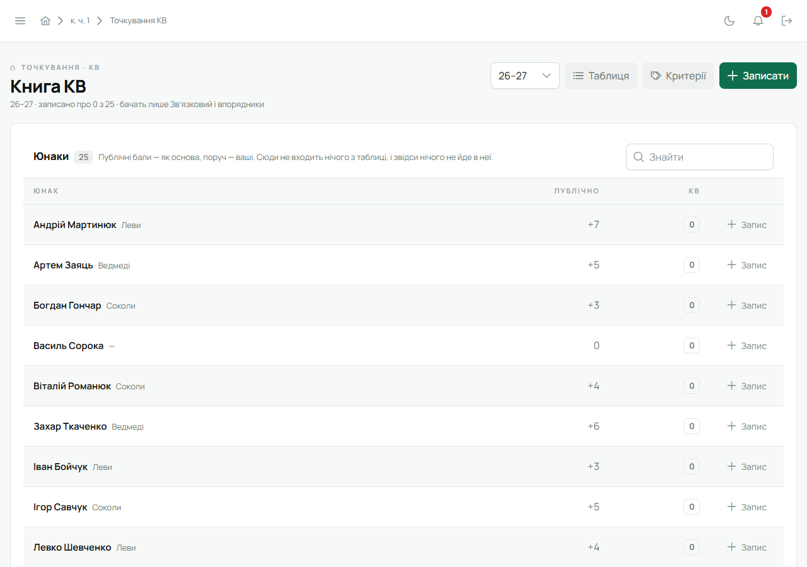

Точкування — змагання **гуртків** куреня. Бал гуртка складається з балів його юнаків. Окремого
рейтингу людей немає: свої бали юнак бачить на [головній](/user/features/dashboard/), а курінь —
таблицю гуртків.

«Точкування» в бічному меню відкриває таблицю. Вона видна всьому куреню.

## Звідки беруться бали

- **Присутність** — юнака відмітили на сходинах чи заході. Скільки дає одна присутність, залежить
  від групи подій.
- **Позиції** — бали з переліку куреня: «однострій», «запізнення» тощо. Суддя обирає позицію, і бал
  підставляється сам.
- **Від судді** — довільний бал, плюс чи мінус, з поясненням, за що.
- **Автоматично** — із того, що вже є в Лілейці:
  - підтверджена вмілість;
  - підписана точка проби;
  - складена проба;
  - квартал вкладки, сплачений без боргу;
  - пересторога, що діє, — лише мінус або нуль.

Бал належить гуртку, у якому юнак був того дня. Якщо юнака перевели, зароблене лишається старому
гуртку. Бал можна дати й **гуртку цілим** — він додається до балу гуртка й не ділиться на юнаків.

## Таблиця гуртків

Рядок на гурток: місце, смуга відносно лідера, бал гуртка і поруч друге число.

Як рахується бал гуртка, обирає курінь у налаштуваннях:

- **Середнє на юнака** (за замовчуванням) — бали юнаків, поділені на кількість юнаків. Малий
  активний гурток не програє великому пасивному.
- **Сума балів** — усі бали юнаків разом. Великий гурток має перевагу.

Друге число — те саме, порахуване іншим способом, щоб нікому не доводилось рахувати самому. Юнак, що
був у гуртку половину періоду, рахується як половина.

Період обирають угорі: **пластовий рік** (з IV кварталу) або **етап**, якщо курінь їх завів.

Клік по гуртку відкриває його сторінку: місце, юнаки з розкладом балів за джерелами й усі записи
вручну. Сторінку гуртка бачать ті, хто цей гурток точкує.

## Аркуш присутності

Присутність відмічають на аркуші події. Відкрий подію в [календарі](/user/features/calendar-and-tasks/)
і натисни **«Точкування»**. Другий шлях — [головна](/user/features/dashboard/) → «Справи» →
**«Відмітити присутність»**: там сходини за останні два тижні, де присутність ще ніхто не відмітив.
Відмічати можна від початку події.

Аркуш має три полиці:

1. **Відповіли** — ті, хто відповів «Іду» чи «Можливо». Це лише підказка, а не присутність. Кнопка
   «Усі, хто відповів, були» відмічає їх усіх разом.
2. **Призначені** — решта тих, кому подія адресована.
3. **Решта** — пошук «Знайти юнака» або «Показати» для тих, хто прийшов, хоч їх не кликали.
   Додавати їх — на твій розсуд.

Кругла кнопка біля імені ставить або знімає відмітку. Присутність людини на події записується один
раз, хоч би хто з суддів її ставив: другий суддя бачить, що відмітка вже є і хто її поставив.
Знята відмітка лишає слід.

Суддя бачить свій гурток. Інші гуртки сховано за «Показати інші гуртки».

На аркуші ж можна дати бал юнакові («Бал» у його рядку) чи гуртку цілим (блок «Гуртку цілим» або
кнопка **«Бал гуртку»** вгорі). Суддя куреня може тут змінити бал за
присутність саме на цій події — «Бал за присутність на цій події». «Як у групи» повертає бал групи.

## Бали вручну

На сторінці гуртка — **«Записати бал»**: кому (юнак або гурток цілим), позиція з переліку чи
довільний бал, за що, дата. Запис можна змінити або видалити. Біля кожного запису видно, хто й коли
його дав.

## Налаштування

«Налаштування» на таблиці — для судді куреня й Звʼязкового:

- **Бал гуртка** — середнє на юнака чи сума;
- **Присутність** — скільки балів дає присутність у кожній групі подій. Нуль — така подія не
  точкується;
- **Автоматично** — скільки дає кожне автоматичне джерело. Правило діє з дати; що зароблено раніше,
  лишається як було;
- **Перелік позицій** — позиції для балів вручну. Непотрібну можна відправити в архів і повернути;
- **Етапи** — частини року з назвою й датами, щоб дивитись таблицю за етап.

## Книга КВ

Кнопка **«Точкування КВ»** на таблиці відкриває приватну книгу кадри виховників. Її бачать
лише Звʼязковий і КВ.

- КВ дає бали за **власними критеріями** або з нотаткою. Критерії заводять у «Критерії».
- Книга спільна на все КВ: біля запису видно, хто його зробив.
- У книзі є будь-який юнак куреня. Поруч із приватними балами видно його публічний бал.
- **Приватні бали ніколи не потрапляють у публічну таблицю** — вони зберігаються окремо.

## Хто що може

| | Бачить | Ставить бали | Налаштування | Книга КВ |
|---|---|---|---|---|
| Юнак, писар, скарбник | таблицю гуртків, свої бали на головній | — | — | — |
| Суддя гуртка, гуртковий, впорядник | таблицю й свій гурток | у своєму гуртку | — | впорядник — так |
| Інструктор | таблицю гуртків | — | — | так |
| Суддя куреня, курінний | таблицю й усі гуртки | в усіх гуртках | суддя куреня | — |
| Звʼязковий | усе | в усіх гуртках | так | так |

## На телефоні

«Меню» → **«Точкування»**: таблиця гуртків, сторінка гуртка, аркуш присутності й бали. «Точкування
КВ» і «Налаштування» є лише у вебі.
