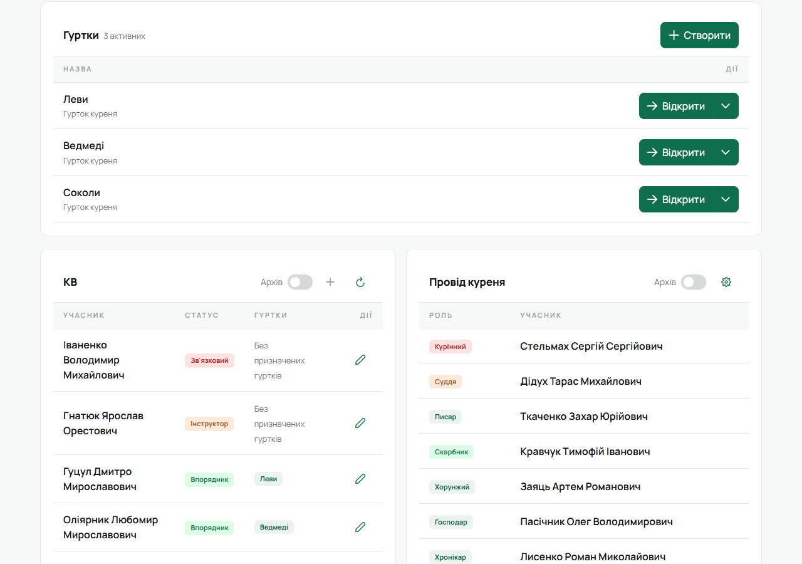
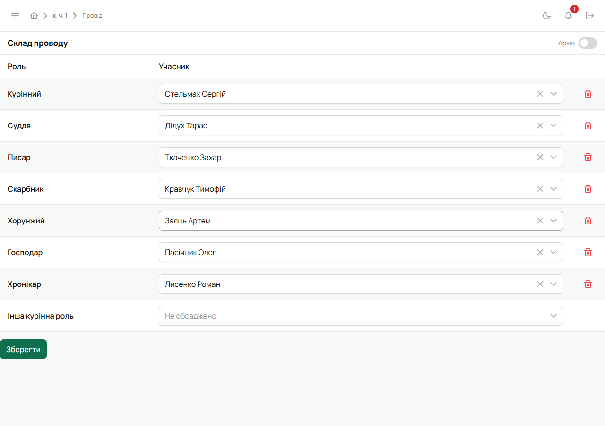
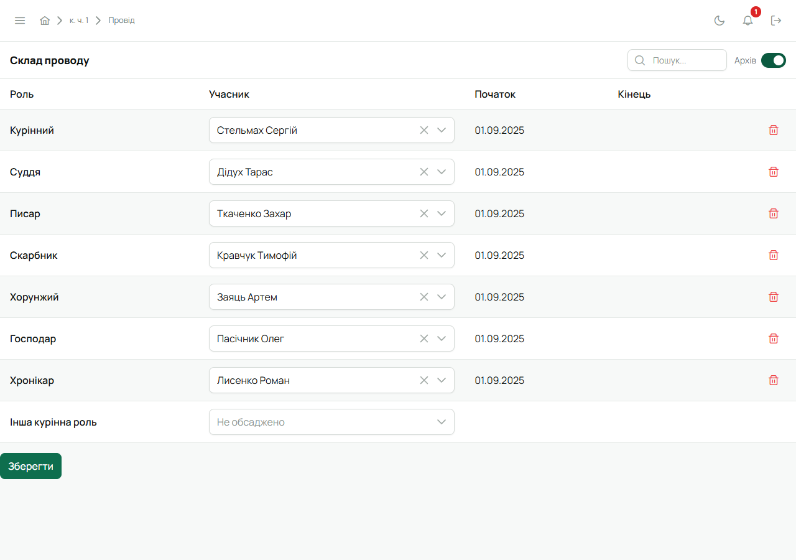

Права в Лілейці випливають із ролей, тож «дати людині права» означає записати її роль у проводі.

**Хто записує:**

- провід куреня — Звʼязковий; курінний — решту курінного проводу, але не себе;
- провід гуртка — Звʼязковий і впорядник гуртка; гуртковий — решту проводу свого гуртка, але не себе.

Курінного призначає Звʼязковий, гурткового — впорядник гуртка або Звʼязковий.

## Кроки

1. Відкрий **«Курінь»**. Для проводу гуртка — сторінку потрібного гуртка.
2. У плитці **«Провід куреня»** (або **«Провід гуртка»**) натисни шестерню **«Налаштувати провід»**.

   

3. Відкриється **«Склад проводу»**: кожна роль — рядок, навпроти — людина. Порожня роль показує
   **«Не обсаджено»**.
4. Навпроти потрібної ролі натисни на поле й обери людину — там є пошук за прізвищем.
   - Змінити людину — просто обери іншу.
   - Прибрати людину з ролі — кошик **«Очистити»** праворуч.

   

5. Натисни **«Зберегти»**.

**Дати ставить Лілейка.** Нова людина тримає роль з дня збереження. Попередня, кого замінили чи
прибрали, з цього ж дня в архіві. Вписувати дати вручну не треба.

Права оновляться, щойно людина наступного разу відкриє Лілейку.

## Архів

Перемикач **«Архів»** вгорі показує, хто і з якого дня до якого тримав кожну роль. Дати тут лише
для перегляду.

## Що врахувати

- Кожну роль тримає одна людина.
- Впорядник — не роль проводу. Його закріплюють за гуртком окремо: [Закріпити впорядника за
  гуртком](/user/howto/assign-mentor/).
- Про зміну проводу Лілейка сповіщень не надсилає — скажи людині сам.

## На телефоні

Вкладка **«Курінь»** → «Провід куреня» → **«Налаштувати провід»**. Для гуртка — сторінка гуртка →
«Налаштувати провід».
