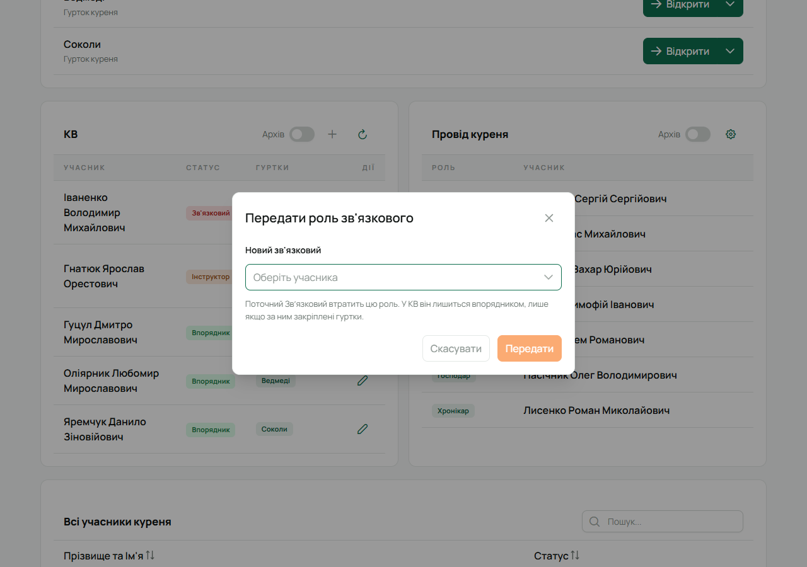

У КВ (кадрі виховників) є три ролі:

- **Звʼязковий** — керує КВ; гуртки може мати, а може й ні.
- **Впорядник** — людина, яку закріпили хоча б за одним гуртком.
- **Інструктор** — людина з КВ і з правами КВ, але без закріпленого гуртка.

Роль у плитці визначають гуртки: зʼявився гурток — людина стала впорядником, прибрали всі гуртки —
інструктором. Робити це може тільки Звʼязковий (і адміністратор).

## Додати до КВ

1. Відкрий **«Курінь»** і знайди плитку **«КВ»**.
2. Натисни **+** («Додати до КВ»).
3. У вікні **«Учасник КВ»** обери людину в полі **«Оберіть учасника»** і гуртки в полі
   **«Оберіть гуртки»**. Гуртків може бути кілька. Без гуртків людина стане інструктором.
4. Натисни **«Зберегти»**.

Щойно впорядник наступного разу відкриє Лілейку, він бачить свої гуртки: може редагувати учасників,
підписувати точки проби, розглядати вмілості, вести календар, задачі, касу й точкування гуртка.

## Змінити гуртки

- У рядку людини натисни олівець **«Налаштувати гуртки»** і зміни перелік.
- Другий шлях — зі сторінки гуртка: **«Редагувати»** → **«Впорядники»** → обери людей із КВ, які
  вестимуть цей гурток.
- Якщо прибрати всі гуртки, людина лишиться в КВ інструктором. Зняті закріплення видно в
  **«Архів впорядників»** — увімкни перемикач **«Архів»** угорі плитки.

## Передати роль Звʼязкового

У плитці «КВ» є кнопка зі стрілкою-колом **«Передати роль звʼязкового»** — її легко сплутати з
«оновити», наведи, щоб побачити підказку.

1. Натисни її й обери нового Звʼязкового в полі **«Новий зв'язковий»**.
2. Натисни **«Передати»**.

Обрана людина стає Звʼязковим, а ти цю роль втрачаєш. У КВ ти лишишся впорядником, лише якщо за
тобою закріплені гуртки; інакше попроси нового Звʼязкового додати тебе знову. Ролі в проводі
куреня від цього не змінюються.

## На телефоні

Вкладка **«Курінь»** → **«КВ»**: «Звʼязковий і впорядники» з гуртками кожного, **«Додати до КВ»**,
**«Передати роль Звʼязкового»** і «Архів впорядників». Зі сторінки гуртка — «Впорядники».
