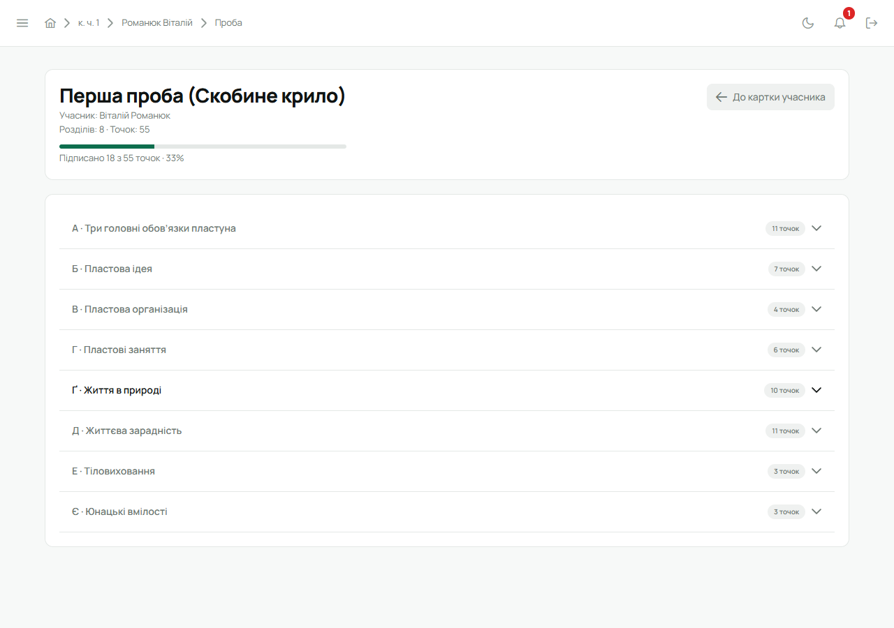
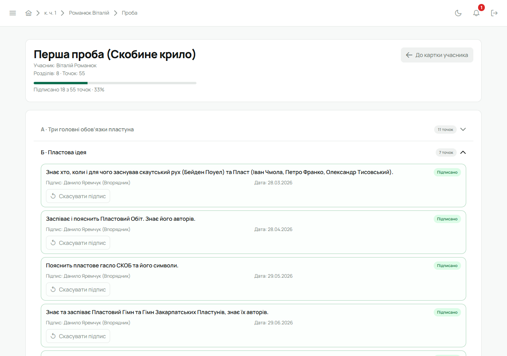

Пробу юнака веде його впорядник (і Звʼязковий). Юнак бачить свою пробу і хто що підписав, але
підписувати не може.

Проби є лише в куренях УПЮ: у куренях УСП та УПС їх немає (див. [Гілки куренів](/user/features/branches/)).

## Відкрити пробу

1. Відкрий картку юнака (з гуртка чи списку учасників).
2. У плитці **«Проба»** біля потрібної проби натисни **«Деталі»**.

Відкриється сторінка проби: вгорі — скільки точок підписано, нижче — розділи (А, Б, В…) з кількістю
точок у кожному.

Друга проба відкривається лише тоді, коли закрито першу.

## Підписати точку

1. Розгорни розділ.
2. Біля точки, яку юнак виконав, натисни **«Підписати»**. Під точкою зʼявиться, хто підписав і
   коли.

Помилився — **«Скасувати підпис»** біля тієї самої точки.

## Закрити пробу

Коли підписано всі точки, вгорі сторінки зʼявиться **«Усі точки підписані»** і кнопка
**«Здати і закрити пробу»**.

1. Натисни **«Здати і закрити пробу»** і підтверди.
2. Перша проба після закриття відкриває другу. Друга проба записує в картку дату її здобуття.

Закрита проба лишається видно — лише для перегляду, без кнопок підпису.

## На телефоні

Картка юнака → **«Проба»** → потрібна проба. Підписують і закривають так само.
