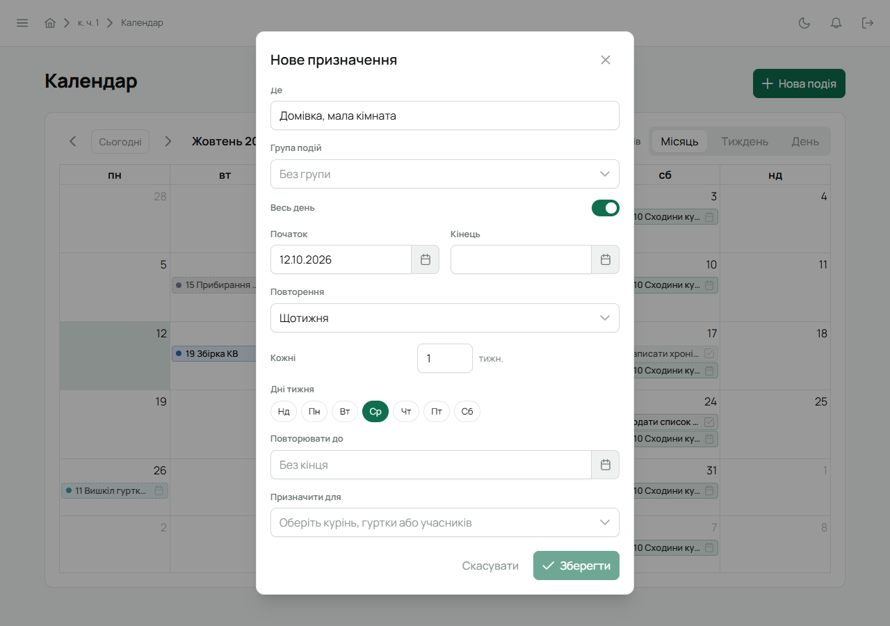
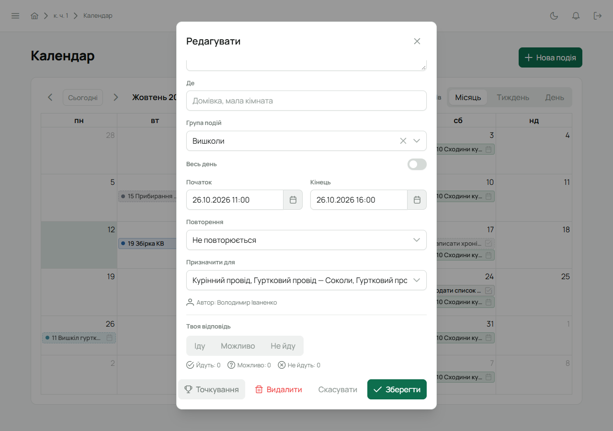

Подію в календарі створює будь-хто з проводу: Звʼязковий, впорядник, інструктор, провід куреня
й гуртків. Учасник подій не створює, але бачить ті, що стосуються його, і відповідає, чи прийде.

## Кроки

1. Відкрий **«Календар»** у бічному меню і натисни **«Нова подія»** вгорі праворуч.

   

2. Відкриється вікно **«Нове призначення»**. Тип лиши **«Подія»** (задачі — окрема
   [інструкція](/user/howto/create-task/)).
3. Заповни:
   - **Назва** — як подію бачитимуть у календарі й на головній: «Сходини гуртка «Орли»».
   - **Опис** — деталі, необовʼязково. Якщо обрати групу з шаблоном опису, він підставиться сам.
   - **Де** — місце: «Домівка, мала кімната».
   - **Група подій** — Сходини, Вишколи, Табори тощо. Від групи залежить колір, значок, чи питати
     «Іду / Не йду», ліміт місць і тривалість. Групи налаштовує Звʼязковий —
     див. [Групи подій](/user/howto/event-groups/).
   - **Весь день** — для таборів і свят. Вимкни, щоб задати години.
   - **Початок** і **Кінець** — дата (і час, якщо не весь день).

4. Якщо подія повторюється — обери **«Повторення»**: «Щотижня», «Щомісяця» чи «Щороку». Для
   щотижневої зʼявляться:
   - **Кожні … тижн.** — 1 для щотижневих сходин, 2 — для сходин через тиждень;
   - **Дні тижня** — позначте потрібні (можна кілька);
   - **Повторювати до** — дата, після якої подія більше не зʼявляється. Порожнє — без кінця.

   

5. **Призначити для** — кому подія: увесь курінь, окремі гуртки, провід куреня, провід гуртків чи
   конкретні люди. Можна обрати кілька. Подію бачать ті, кому вона призначена, її автор і
   Звʼязковий. Події груп із позначкою «Графік куреня» бачить увесь курінь, якщо ввімкнути в
   календарі **«Графіки гуртків»** — лише для перегляду, без відповідей.
6. Натисни **«Зберегти»**.

Повторювана подія розгортається за місцевим часом: година сходин не зсувається, коли переводять
годинник на літній чи зимовий час.

## Хто прийде

Якщо група події питає відповідь, кожен, кому подія призначена, бачить кнопки
**«Іду / Можливо / Не йду»** — у вікні події та прямо на [головній](/user/features/dashboard/).
Відповідь на повторювану подію стосується **лише цієї дати**: на наступні сходини людина відповідає
окремо.

Відкрий подію в календарі — внизу видно твою відповідь і підсумок: скільки **йдуть**, скільки
**можливо**, скільки **не йдуть**, а для груп із лімітом місць — скільки **в черзі**. Нижче —
список людей з їхніми відповідями.

**Ліміт місць і черга.** Ліміт місць працює разом із чергою. Якщо в групі події ввімкнено «Черга
при переповненні», перші «Іду» в межах ліміту йдуть, решта стають у чергу в порядку відповідей.
Коли хтось із тих, хто йде, передумає, його місце займає перший з черги. Хто сам передумав і знову
відповів «Іду», стає в кінець черги. Без черги ліміт — лише орієнтир: «Іду» приймаються від усіх.

## Змінити чи видалити подію

Відкрий подію в календарі — якщо тобі можна її змінювати, вікно називатиметься **«Редагувати»**.
Зміни поля й натисни **«Зберегти»**, або **«Видалити»**, щоб прибрати подію. Змінювати може автор
події, впорядник гуртка, якому вона призначена, і Звʼязковий. Гуртковий чи курінний змінюють лише
те, що створили самі.

Кнопка **«Точкування»** у вікні події відкриває аркуш присутності — див.
[Точкування](/user/features/score/).

## На телефоні

Вкладка **«Календар»** → **+** угорі праворуч. Поля ті самі. Відповісти на подію можна на
вкладці «Головна» або відкривши подію.
