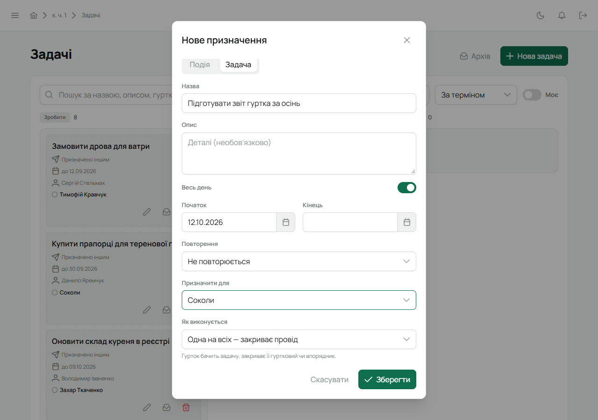
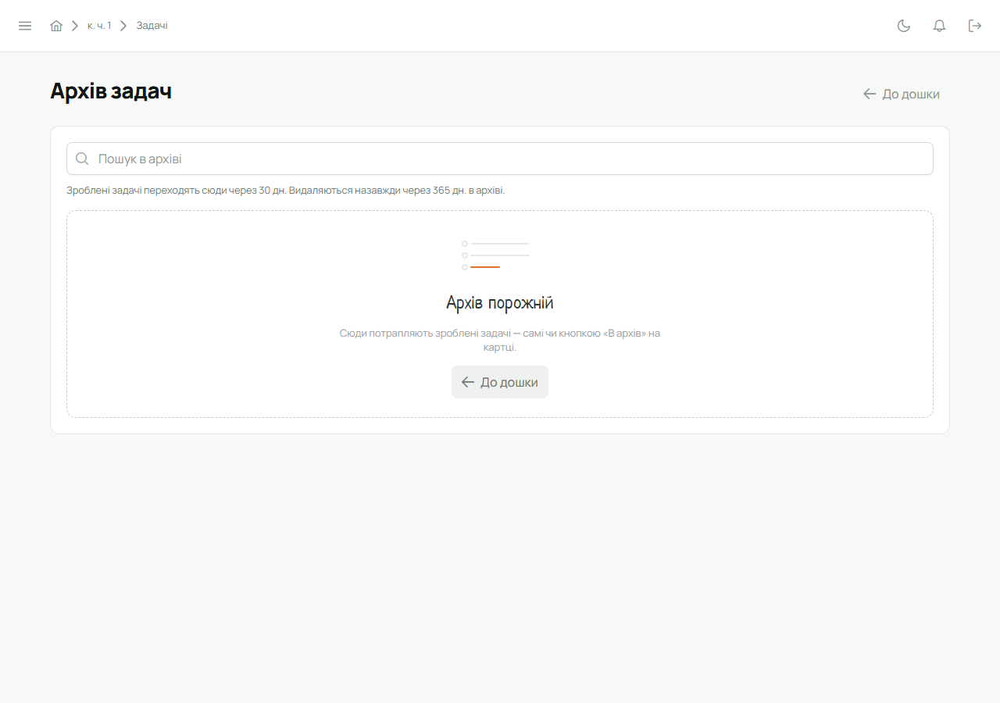

Задачі ставить будь-хто з проводу. Учасник бачить задачі, призначені йому чи його гуртку, і
переносить їх між колонками, якщо йому можна закривати.

## Кроки

1. Відкрий **«Задачі»** в бічному меню і натисни **«Нова задача»**.

   

2. У вікні **«Нове призначення»** тип уже **«Задача»**.
3. Заповни **Назву** і, якщо треба, **Опис**.
4. **Початок** і **Кінець** — коли задачу треба зробити. Кінець — це термін: прострочені задачі
   підсвічуються червоним.
5. **Призначити для** — людині, гуртку, кільком гурткам, проводу куреня чи всьому куреню.
6. Якщо задачу призначено гуртку, проводу чи куреню, зʼявиться **«Як виконується»**:
   - **Одна на всіх — закриває провід** (типово) — гурток бачить задачу, а закриває її гуртковий
     чи впорядник;
   - **Одна на всіх — закриває будь-хто** — досить, щоб зробив один, і видно, хто саме;
   - **Кожному окремо** — кожен робить свою частину, задача зроблена, коли зробили всі.

   

7. Натисни **«Зберегти»**. Задача зʼявиться в колонці **«Зробити»**.

Задача кільком гурткам має стан для кожного: гурток, що впорався, бачить її в «Зроблено», решта —
далі у своїх колонках.

## Перенести між колонками

Перетягни картку в колонку **«В процесі»** чи **«Зроблено»**. На вузькому екрані колонки стають
вкладками — тоді затисни картку й перетягни її на потрібну вкладку. Біля зробленого завжди
написано, хто закрив і коли.

На телефоні — торкнись кружечка ліворуч від назви або потягни рядок праворуч
(див. [Лілейка на телефоні](/user/features/mobile-app/#задачі-на-телефоні)).

## Знайти задачу

Над дошкою — пошук за назвою, описом чи гуртком, фільтр за ціллю, сортування і перемикач
**«Моє»** — лише задачі, де наступний крок за тобою.

## Архів

Зроблені задачі через 30 днів самі переходять в **«Архів»** (кнопка над дошкою). Перенести задачу
в архів раніше можна значком на картці, а повернути з архіву — кнопкою «Повернути». Скільки задачі
лежать в архіві, перш ніж зникнути назовсім, Звʼязковий задає в «Налаштуваннях куреня» →
«Архів задач».

## Змінити чи видалити

Олівець на картці відкриває задачу для редагування, кошик — видаляє. Змінювати може автор задачі,
впорядник гуртка, якому вона призначена, і Звʼязковий. Гуртковий чи курінний змінюють лише
те, що створили самі.
