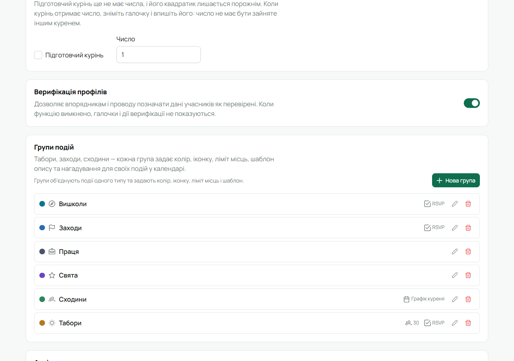
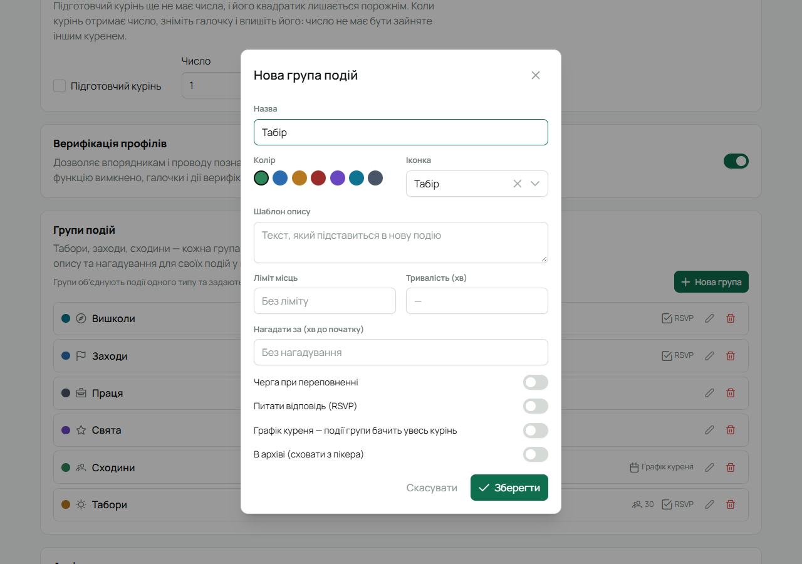

Група подій — це тип подій куреня: Сходини, Вишколи, Табори, Заходи, Свята. Подія, віднесена до
групи, бере з неї колір і значок у календарі та правила: чи питати «Іду / Не йду», скільки місць,
чи бачить її весь курінь. Групи налаштовує **Звʼязковий**.

## Де

**«Налаштування куреня»** у бічному меню → розділ **«Групи подій»**. Тут видно всі групи з
позначками: ліміт місць, RSVP, «Графік куреня».

## Створити чи змінити групу

1. Натисни **«Нова група»** (або олівець біля наявної).
2. Заповни:
   - **Назва** — «Табір», «Сходини», «Вишкіл».
   - **Колір** і **Іконка** — як події групи виглядатимуть у календарі.
   - **Шаблон опису** — текст, який сам підставиться в нову подію цієї групи (наприклад, що взяти
     з собою на табір).
   - **Ліміт місць** — скільки місць на події. Справді обмежує лише разом із чергою (нижче); без
     черги це орієнтир. Порожнє — без ліміту.
   - **Тривалість (хв)** — скільки триває подія, щоб кінець ставився сам.
   - **Черга при переповненні** — коли місця закінчились, наступні «Іду» стають у чергу і
     займають місце того, хто передумав, у порядку відповідей.
   - **Питати відповідь (RSVP)** — показувати кнопки «Іду / Можливо / Не йду» на подіях групи.
   - **Графік куреня** — події групи бачить увесь курінь, навіть якщо подію призначено одному
     гуртку, коли в календарі ввімкнено «Графіки гуртків». Лише для перегляду: відповідати на
     чужі сходини не можна. Зручно, щоб курінь бачив, коли в кого сходини.
   - **В архіві** — група більше не пропонується для нових подій; старі події лишаються.

   

3. Натисни **«Зберегти»**.

:::note[Поле «Нагадати за»]
Поле зберігається, але нагадувань поки ніхто не надсилає. Не розраховуй на нього, доки в
[нотатках релізів](/user/about/) не зʼявиться, що нагадування запрацювали.
:::

## Видалити групу

Кошик біля групи. Події цієї групи не зникнуть, але стануть «Без групи» — втратять колір, значок і
правила групи. Якщо групою вже позначено події, краще ввімкнути **«В архіві»**: події лишаться у
своїй групі, а нові до неї вже не додадуть.

## На телефоні

Групи подій налаштовуються лише у вебі («Налаштування куреня» з телефона відкривають веб).
