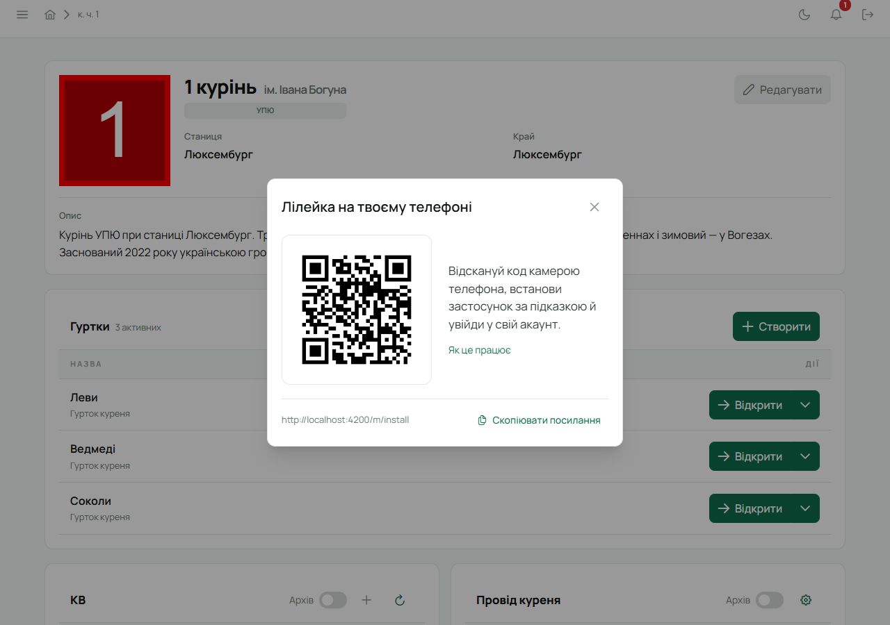
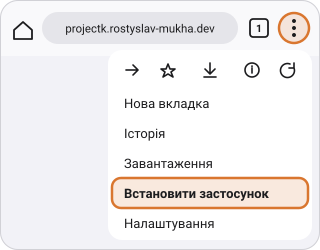
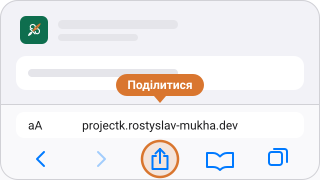
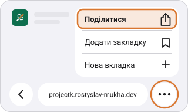
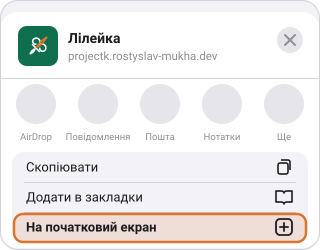
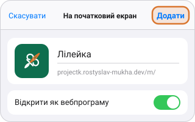
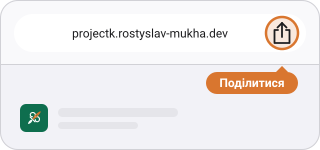
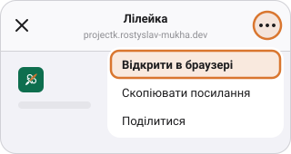
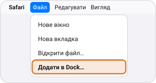

Лілейку не треба шукати в Play Market чи App Store: її ставлять просто з сайту. Після цього в
телефоні зʼявляється іконка Лілейки, вона відкривається у своєму вікні без адресного рядка, як
звичайний застосунок, і може надсилати сповіщення.

Найпростіше — відкрити на телефоні сторінку
**[projectk.rostyslav-mukha.dev/m/install](https://projectk.rostyslav-mukha.dev/m/install)** (на
власному сервері куреня — `/m/install` на його адресі): вона
сама розпізнає телефон і браузер і покаже або кнопку «Встановити», або кроки з картинками саме
для твого випадку.

## Сидиш за компʼютером

Застосунок ставиться на телефон, тому з компʼютера його просто «передають» на телефон:

1. У бічному меню вебу натисни **«Встановити на телефон»**. Відкриється віконце «Лілейка на твоєму
   телефоні» з QR-кодом.

   

2. Наведи на код камеру телефона й торкнись посилання, яке вона покаже. На телефоні відкриється
   сторінка встановлення.
3. Встанови Лілейку за підказкою на цій сторінці (нижче розписано для [Android](#android) і
   [iPhone](#iphone-і-ipad)).
4. Відкрий Лілейку з нової іконки й увійди своїм акаунтом.

Камера не бачить коду? Під ним є посилання і кнопка **«Скопіювати посилання»**: надішли його собі
в месенджер і відкрий уже на телефоні. Код веде на адресу саме твого сервера Лілейки, тож на
власному сервері куреня він теж працює.

Хочеш Лілейку в окремому вікні на самому компʼютері — про це розділ [«Компʼютер»](#компʼютер).

:::note[Телефон одразу відкриває мобільну версію]
Звичайна адреса Лілейки на телефоні сама переходить у мобільну версію (`/m/`) — на той самий
екран і з тим самим входом. Потрібна повна версія сайту? «Меню» → **«Повна версія»**: телефон
запамʼятає вибір, а повернутись можна посиланням **«Мобільна версія»** вгорі сторінки. Сторінки з
листів (активація, новий пароль) і заявка куреня завжди відкриваються як є.
:::

## Android

**В одне натискання.** У Chrome (а також Edge, Samsung Internet, Opera) натисни **«Встановити»** —
на сторінці встановлення, на екрані входу («Встановити застосунок») або в картці на Головній. Телефон спитає «Встановити
застосунок?» — підтверди **«Встановити»**. Іконка зʼявиться серед застосунків, вхід зберігається.

**Через меню браузера**, якщо кнопки немає:

1. Натисни **«⋮»** угорі праворуч і вибери **«Встановити застосунок»**. Пункт може називатися
   «Додати на головний екран».

   

2. Підтвердь: **«Встановити»**.

   

У Samsung Internet: **«≡»** унизу праворуч → **«Додати сторінку до»** → **«Головний екран»**.
У Firefox: **«⋮»** → **«Встановити»** (у старших версіях — «Додати на головний екран»).
Якщо в меню Chrome є «Відкрити в застосунку» — Лілейку вже встановлено.

## iPhone і iPad

На iPhone кнопки «Встановити» не буває — Apple дозволяє лише додати сайт на початковий екран
вручну. Це три кроки в **Safari**:

1. Натисни **«Поділитися»** в нижній панелі Safari (на iPad — угорі праворуч).

   

   На **iOS 26** кнопка «Поділитися» ховається за **«⋯»** праворуч від адреси:

   

2. У меню прогорни вниз і вибери **«На початковий екран»**.

   

3. Натисни **«Додати»** вгорі праворуч. Якщо є перемикач «Відкрити як вебпрограму», лиши його
   увімкненим.

   

:::note[Увійди ще раз]
Лілейка на початковому екрані не бачить входу з Safari: iPhone тримає їх окремо. Відкрий її з
нової іконки й увійди один раз — далі вхід зберігається.
:::

**Сповіщення** на iPhone приходять лише в Лілейку з початкового екрана і лише на iOS 16.4 або
новішій. Увімкнути їх — у «Меню» → «Сповіщення на телефон».

**Chrome, Edge і Firefox на iPhone** теж уміють додавати на початковий екран (з iOS 16.4): у Chrome
кнопка **«Поділитися»** стоїть праворуч в адресному рядку, в Edge — у меню «⋯», у Firefox — у
меню «☰». Далі ті самі «На початковий екран» і «Додати».

На старших iOS це вміє лише Safari.

## Посилання відкрилося в Telegram, Instagram, Viber…

Месенджери й соцмережі відкривають посилання у власному вбудованому браузері, а звідти
встановити Лілейку не можна. Сторінка встановлення це помітить і попросить:

1. Натиснути **«⋯»** або **«⋮»** угорі праворуч і вибрати **«Відкрити в браузері»** (буває
   «Відкрити в Safari» чи «Відкрити в Chrome»).

   

2. Якщо такого пункту немає — **«Скопіювати посилання»** на сторінці і вставити його в адресний
   рядок Safari (iPhone) або Chrome (Android). На Android є ще кнопка **«Відкрити в Chrome»**.

## Компʼютер

Лілейка зроблена під телефон, але її можна поставити й на компʼютер — тоді вона відкривається в
окремому вікні.

- **Chrome чи Edge:** значок встановлення праворуч в адресному рядку → **«Встановити»**.

  

  Значка немає? У Chrome — меню **«⋮»** → **«Трансляція, збереження та надсилання»** →
  **«Установити сторінку як додаток»**; в Edge — меню **«⋯»** → **«Програми»** → **«Інсталювати
  цей сайт як програму»**.

- **Safari на Mac** (macOS Sonoma 14 і новіші): меню **«Файл»** → **«Додати в Dock…»**.

  

- **Firefox** вебзастосунків не встановлює — скористайся Chrome, Edge або телефоном.

## Як прибрати

- **Android:** утримуй іконку Лілейки → **«Видалити»** (або «Інформація про застосунок» →
  «Видалити»).
- **iPhone:** утримуй іконку → **«Видалити програму»** → «Видалити».
- **Chrome чи Edge на компʼютері:** у вікні Лілейки меню «⋮» → «Видалити Лілейку».
- **Mac:** перетягни Лілейку з Dock або видали її з теки «Програми».

Дані в Лілейці від цього не зникають: вони на сервері, і їх видно знову після входу.
