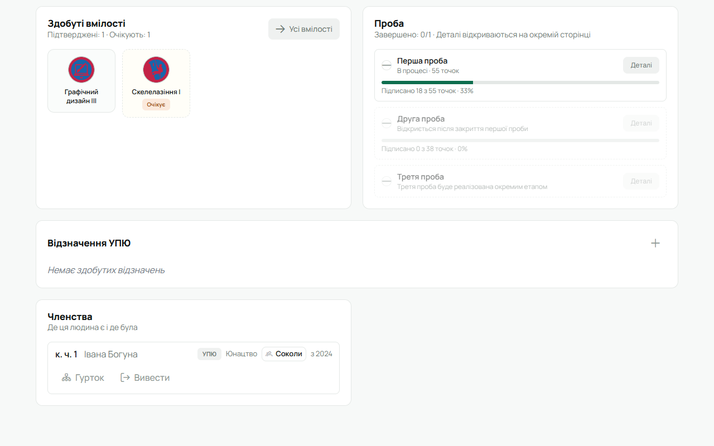
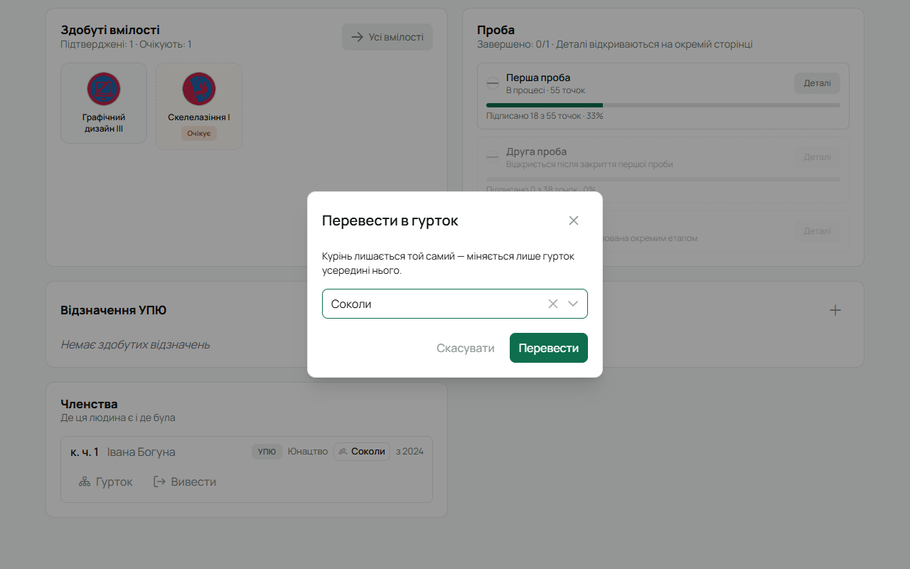
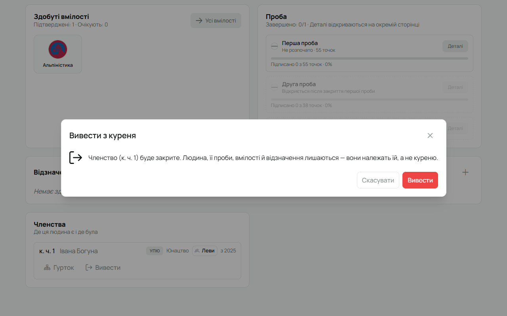
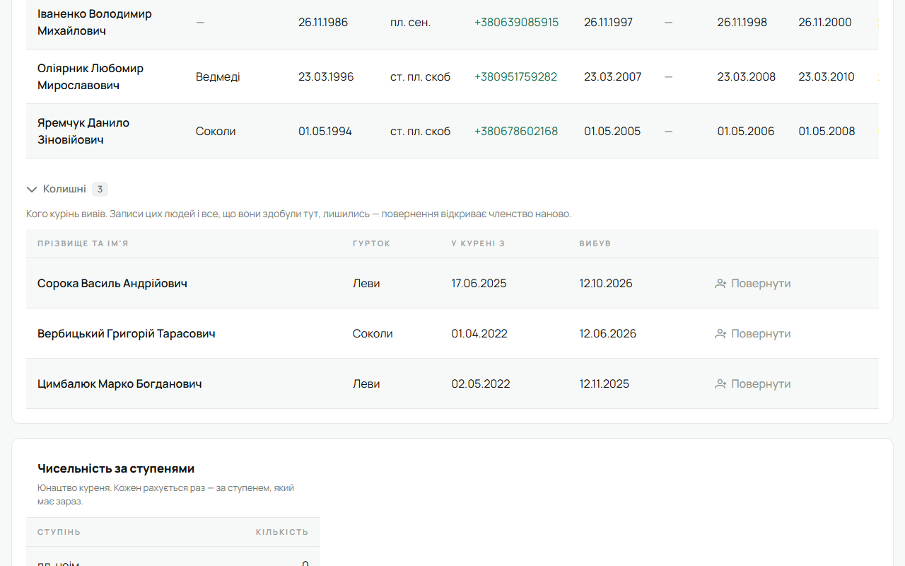
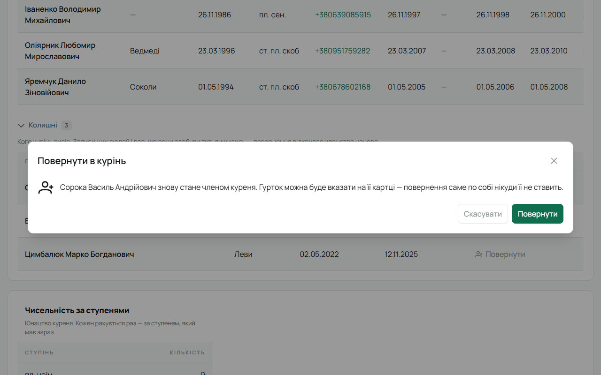
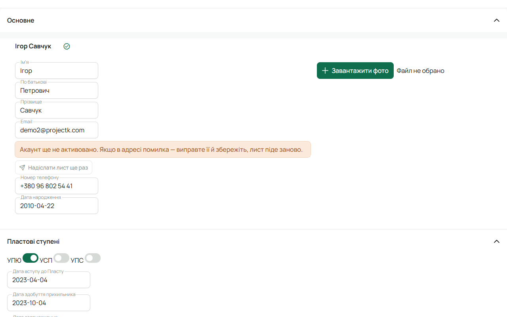

Людина в Лілейці — одна на все життя: її проби, вмілості й відзначення належать їй, а не куреню.
Курінь має лише **членство**. Тому людину не «переносять» між куренями і не «видаляють», коли вона
пішла: членство відкривають, змінюють і закривають, а історія лишається з людиною.

Усе на цій сторінці робить **Звʼязковий** (і адміністратор). Додати в гурток нову людину, якої ще
немає в Лілейці, може й впорядник цього гуртка — див. [Роль впорядника](/user/roles/mentor/).

## Перевести в інший гурток

1. Відкрий картку людини й прокрути до плитки **«Членства»**.

   

2. У рядку свого куреня натисни **«Гурток»**.
3. Обери новий гурток (або очисти поле — тоді людина буде поза гуртком) і натисни **«Перевести»**.

   

Курінь лишається той самий, міняється лише гурток. Точкування й вкладка попереднього гуртка
зберігають те, що людина заробила й здала там: вона значиться там як «переведений».

## Вивести з куреня

Коли людина пішла з куреня — переїхала, закінчила, перейшла в інший курінь.

1. На картці людини в плитці **«Членства»** натисни **«Вивести»**.
2. Підтверди **«Вивести»**.

   

Членство закривається, людина зникає зі списків куреня. Сама людина, її проби, вмілості й
відзначення лишаються — вони належать їй. У «Членствах» на її картці цей курінь переходить у
«Раніше». Вкладка: якщо людина пішла з боргом, вона лишається в розділі «Переведені й вибулі з
боргом» каси гуртка.

## Повернути колишнього

Якщо людина повернулась у курінь:

1. Відкрий **«Реєстр»** і прокрути вниз до **«Колишні»** — розгорни список.

   

2. Біля потрібної людини натисни **«Повернути»** і підтверди.

   

Членство відкривається наново, людина знову серед учасників.

## Надіслати запрошення ще раз

Коли людину додають з акаунтом, на її пошту йде лист з посиланням для активації. Якщо лист не
дійшов або посилання застаріло:

1. Відкрий картку людини → **«Редагувати»**.
2. Під полем Email видно **«Акаунт ще не активовано»**.
   - Пошта правильна — натисни **«Надіслати лист ще раз»**. Попереднє посилання перестане діяти.
   - У пошті помилка — виправ її і натисни **«Зберегти»**: лист піде на нову адресу.

   

Попроси людину перевірити теку «Спам». Сама людина теж може попросити новий лист: на сторінці
входу «Забули пароль?» надсилає запрошення ще раз, якщо акаунт не активований.

## Видалити профіль

Це **не те саме, що вивести**. Видалення прибирає людину з Лілейки назавжди — разом із пробами,
вмілостями, відзначеннями й членствами **в усіх куренях**. Відновити не вийде.

Видаляй лише запис, створений помилково (дублікат, тестовий). Якщо людина просто пішла —
[виведи її](#вивести-з-куреня).

1. Картка людини → **«Редагувати»** → унизу **«Видалити профіль»**.
2. Прочитай попередження й підтверди **«Видалити»**.

Кнопку бачать адміністратор і Звʼязковий.

## На телефоні

- Перевести й вивести — картка людини → **«Членства»**.
- Повернути колишнього — лише у вебі (реєстр).
