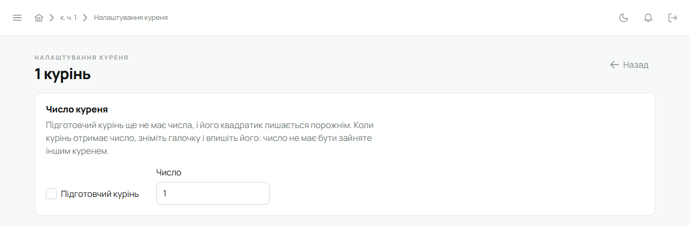

Підготовчий курінь — це курінь, якому ще не надали числа. У Лілейці він працює як звичайний:
гуртки, люди, календар, проби, вкладка — усе є. Відрізняється лише числом: його квадратик (червона
табличка з числом) лишається порожнім, а в списках курінь зветься «підг. курінь» або на честь
кого він.

## Подати заявку

1. Відкрий сторінку заявки — посилання **«Подати заявку»** на сторінці входу.
2. Заповни свої дані, станицю й край.
3. Постав **«Я є зв'язковим куреня»** — заявку на курінь подає Звʼязковий.
4. Постав **«Мій курінь є підготовчим (ще без числа)»**. Поле «Число куреня» зникне, а Лілейка
   нагадає, що число можна вписати пізніше в налаштуваннях.
5. Натисни **«Подати заявку»**.

Адміністратор побачить заявку з позначкою «Підготовчий курінь» і, схваливши її, відкриє курінь
без числа. Тобі прийде лист для активації акаунта — далі все як на [першому вході](/user/start/first-login/).

## Як дати курінню число

Коли курінь отримав число:

1. Бічне меню → **«Налаштування куреня»**.
2. У плитці **«Число куреня»** зніми галочку **«Підготовчий курінь»**.

   

3. У полі **«Число»** впиши число і збережи налаштування.

   

Число має бути від 1 до 200 (на власному сервері межу можна підняти) і не зайняте іншим куренем.
Якщо зайняте — Лілейка скаже про це під полем.

Так само, поставивши галочку назад, можна зробити курінь знову підготовчим.

## Імʼя куреня

Щоб підготовчі курені не зливались в один рядок «підг. курінь», задай, **на честь кого** курінь:
сторінка куреня → **«Редагувати»** → **«Редагування даних куреня»** → поле «Імені / в честь кого» →
**«Зберегти»**. Тоді в
списках, зокрема в адміністратора, курінь буде видно як «підг. курінь ім. …».
