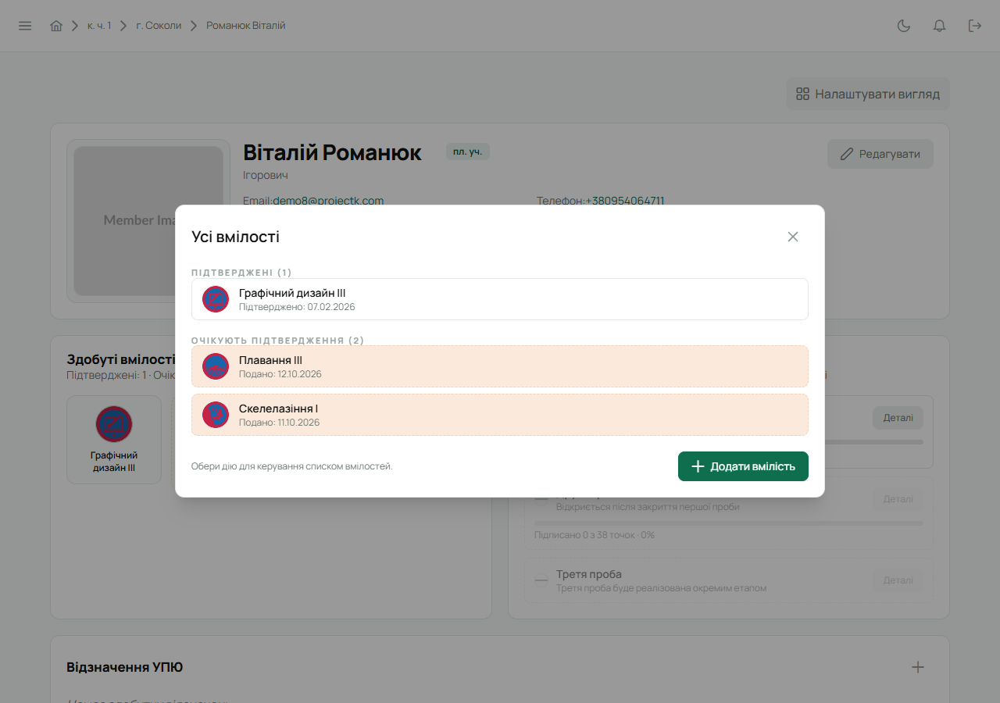
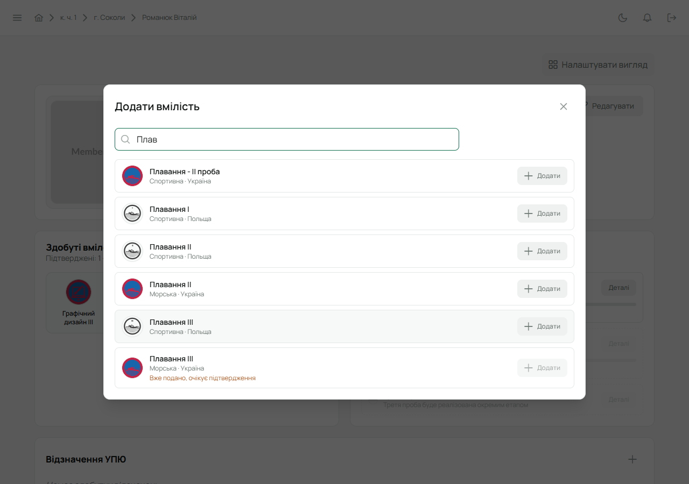
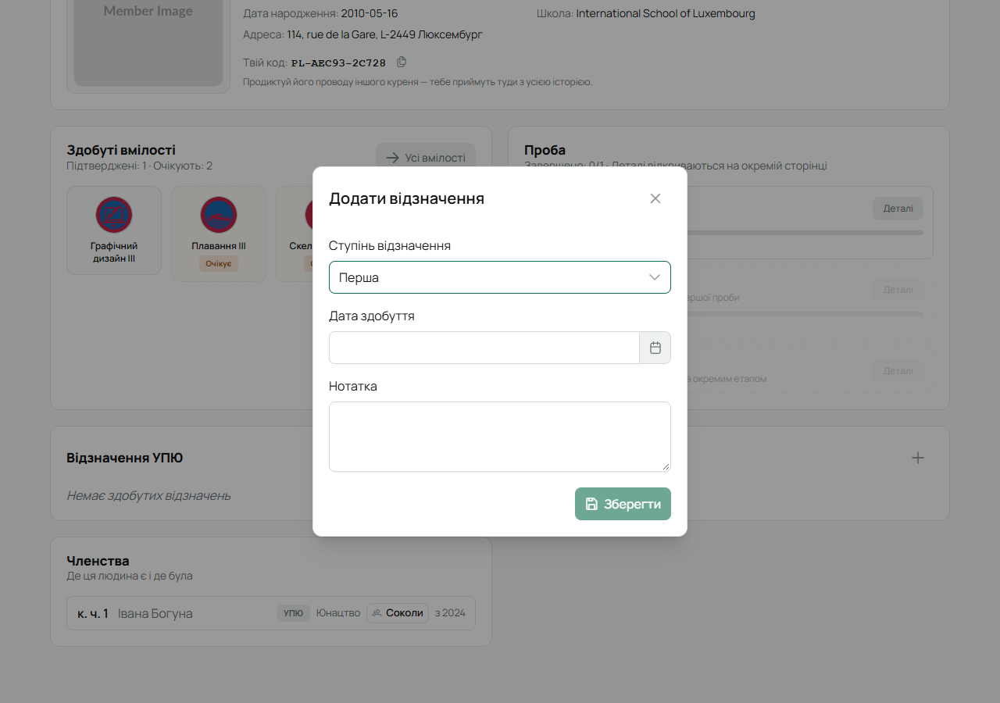
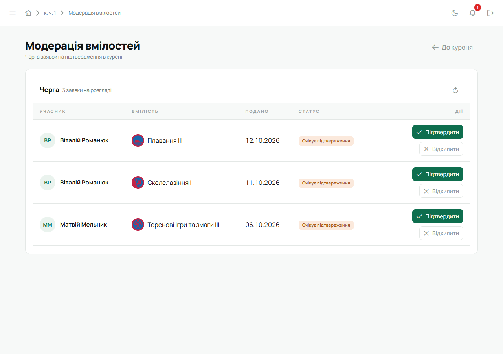

Вмілості й відзначення УПЮ працюють однаково: юнак (або впорядник за нього) **подає**, а впорядник
чи Звʼязковий **підтверджує**. Поки не підтвердили, біля вмілості чи відзначення стоїть
**«Очікує»**.

Вмілості й відзначення УПЮ є лише в куренях УПЮ.

## Подати вмілість

1. Відкрий свою картку («Мій профіль») і в плитці **«Здобуті вмілості»** натисни **«Усі вмілості»**.
   Тут видно підтверджені вмілості й ті, що очікують підтвердження.

   

2. Натисни **«Додати вмілість»**.
3. Почни вводити назву, спеціалізацію чи країну — список звузиться.
4. Біля потрібної вмілості натисни **«Додати»**. Вона зʼявиться серед тих, що очікують.

   

Вмілість, яку ти вже подав, позначена «Вже подано, очікує підтвердження» — двічі її не подати.

Впорядник отримає її на перевірку, а ти — сповіщення, коли її підтвердять.

## Додати відзначення УПЮ

1. На своїй картці в плитці **«Відзначення УПЮ»** натисни **+**.
2. Обери **«Ступінь відзначення»** — Перша, Друга, Третя чи Четверта, впиши **«Дату здобуття»** і,
   за бажанням, **нотатку**.
3. Натисни **«Зберегти»**.

Відзначення зʼявиться з позначкою «Очікує», доки впорядник не підтвердить.

## Підтвердити (для впорядника)

**Вмілості всього куреня** — бічне меню → **«Модерація вмілостей»**. Тут черга всіх поданих
вмілостей: хто, що, коли. Біля кожної — **«Підтвердити»** або **«Відхилити»**. Відхиляючи, можна
пояснити причину — юнак її побачить.

**Вмілості одного юнака** — на його картці **«Усі вмілості»**: біля поданої вмілості можна одразу
підтвердити, а підтверджену — повернути **«До модерації»** чи видалити.

**Відзначення** — на картці юнака в плитці «Відзначення УПЮ» відкрий відзначення з «Очікує» і
натисни ✓, щоб підтвердити, або кошик, щоб видалити.

Пункт «Справи» на [головній](/user/features/dashboard/) показує, скільки вмілостей чекає на тебе.

## На телефоні

- Юнак: «Меню» → профіль → «Усі вмілості» → **«Додати вмілість»**.
- Впорядник: «Меню» → **«Модерація вмілостей»**.
