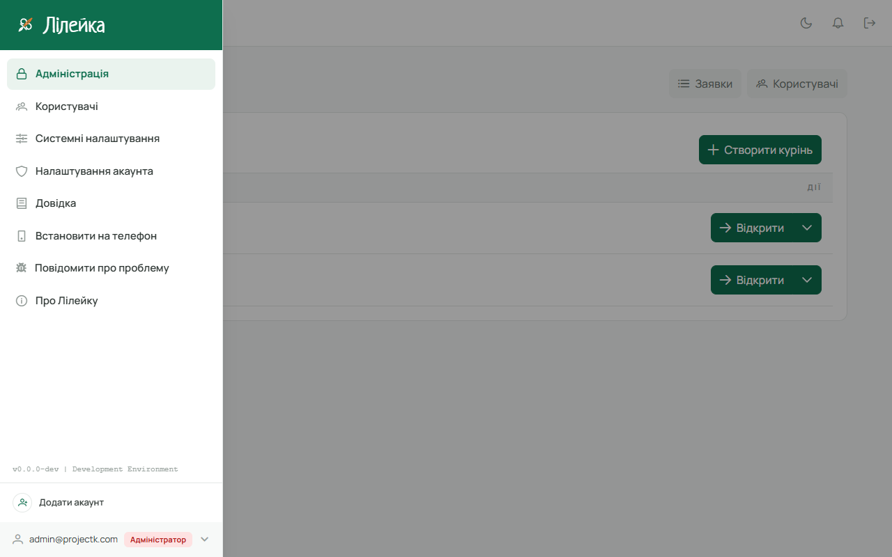
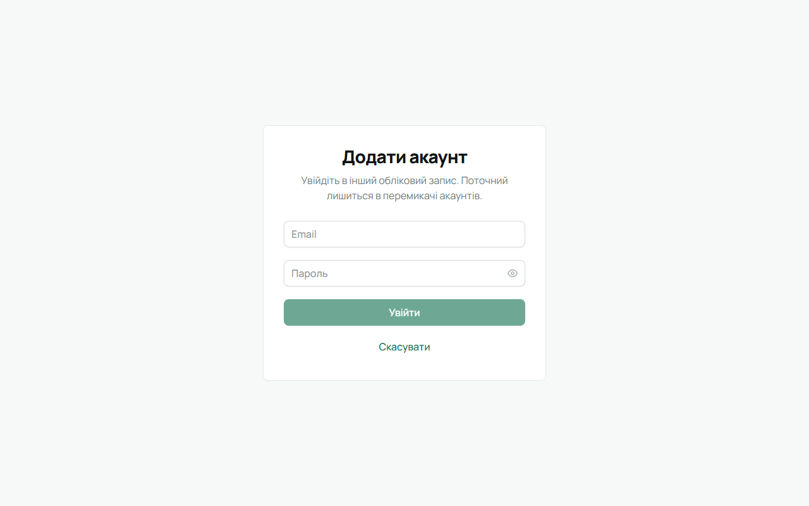
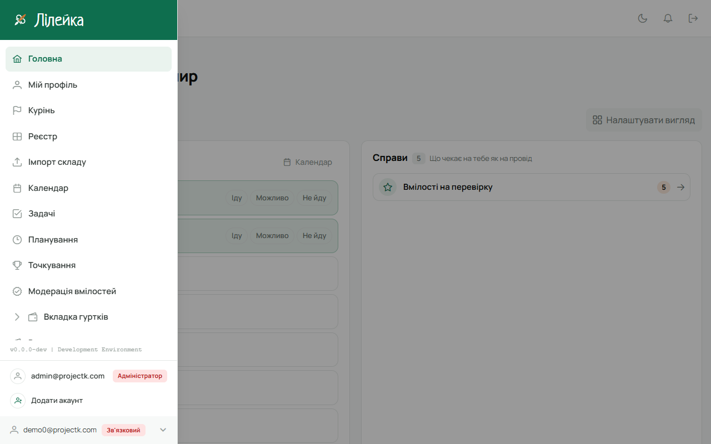

Якщо в тебе кілька акаунтів у Лілейці — наприклад, робочий і адміністраторський, або свій і
тестовий, — не треба щоразу виходити й входити знову. Додай другий акаунт один раз, і далі
перемикайся між ними одним натисканням, без пароля.

На одному пристрої можна тримати до пʼяти акаунтів.

## У вебі

1. Відкрий бічне меню (☰ угорі ліворуч) і натисни на **свій акаунт унизу меню** — рядок з поштою,
   роллю і стрілочкою.

   Над ним розгорнеться список: інші акаунти, у які ти входив на цьому компʼютері, і
   **«Додати акаунт»**.

   

2. Натисни **«Додати акаунт»**. Відкриється сторінка входу з заголовком **«Додати акаунт»**.

   

3. Введи пошту й пароль другого акаунта і натисни **«Увійти»**. Якщо в нього увімкнено
   двофакторний вхід, Лілейка попросить код — як при звичайному вході.

   Передумав — натисни **«Скасувати»**: лишишся в поточному акаунті.

4. Після входу сторінка перезавантажиться вже в новому акаунті. Попередній акаунт тепер у списку
   над твоїм акаунтом.

   

5. Щоб повернутися, знову натисни на свій акаунт унизу меню і вибери потрібний зі списку. Пароль
   не потрібен — сторінка просто перезавантажиться в тому акаунті.

## На телефоні

У мобільній версії те саме лежить у **«Меню»**, одразу під твоїм профілем: інші акаунти з їхніми
ролями і **«Додати акаунт»**. Торкнись акаунта — застосунок перезапуститься в ньому.

## Вихід

**«Вийти»** виходить **з усіх** акаунтів на цьому пристрої одразу — щоб на чужому чи спільному
компʼютері після тебе не лишилося жодного входу. Наступного разу кожен акаунт треба буде додати
знову.

## Корисно знати

- Список акаунтів свій на кожному пристрої й у кожному браузері. Акаунти, додані на ноутбуці, не
  зʼявляться на телефоні.
- Веб і мобільна версія на тому самому телефоні бачать один і той самий список.
- Збережений акаунт тримається **тиждень** від того разу, коли ти востаннє в нього перемикався.
  Не відкривав довше — він сам зникне зі списку. Так само він зникає, якщо в ньому змінили пароль
  чи двофакторний вхід або акаунт призупинили. Тоді просто додай його знову.
- Перемикач працює лише на сайті з HTTPS. На власному сервері куреня без HTTPS інші акаунти не
  запамʼятовуються (окрім `localhost`).
- Сповіщення на телефон (push) лишаються за тим акаунтом, у якому їх увімкнули.
