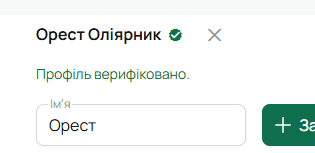
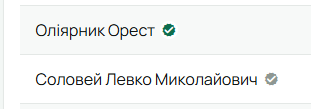

Верифікація — позначка, що дані в картці звірені з документами чи з батьками. Вона необовʼязкова:
курінь вирішує сам, чи користуватися нею.

## Увімкнути в курені

Робить Звʼязковий, один раз:

1. «Курінь» → **«Редагувати»** → **«Налаштування куреня»**.
2. У плитці **«Верифікація профілів»** увімкни перемикач і натисни **«Зберегти»** внизу.

Після цього в картках і списках зʼявляється значок верифікації, а у формі учасника — кнопка для неї.

## Підтвердити дані юнака

Може впорядник свого гуртка або Звʼязковий:

1. Відкрий картку юнака і натисни **«Редагувати»**.
2. Звір імʼя, дату народження, ступені, контакти.
3. Біля імені вгорі натисни кнопку з галочкою **«Верифікувати профіль»**. Зʼявиться «Профіль
   верифіковано».

   

У картці й у списках біля імені зʼявиться зелений значок із підказкою **«Дані верифіковано»**, а
в картці — дата перевірки. Юнак отримає сповіщення **«Профільні дані підтверджено»**.

## Коли позначка застаріває

Якщо потім у картці змінити щось суттєве — імʼя, по батькові, дату народження, контакти,
ступені, гурток — значок стане сірим, а підказка скаже **«Дані змінено після
верифікації»**, а впорядники гуртка й Звʼязковий отримають сповіщення **«Профіль потребує повторної
перевірки»** (крім того, хто сам вніс зміну). Перевір зміни і натисни кнопку ще раз.

Ступені може вписати й сам юнак — тоді верифікація так само знімається, доки провід її не
перевірить.

Зняти верифікацію можна тією ж кнопкою: коли профіль верифіковано, вона підписана **«Зняти
верифікацію профілю»**.

## На телефоні

Картка юнака → **«Редагувати»** → розділ **«Верифікація профілю»** → **«Верифікувати профіль»**.
