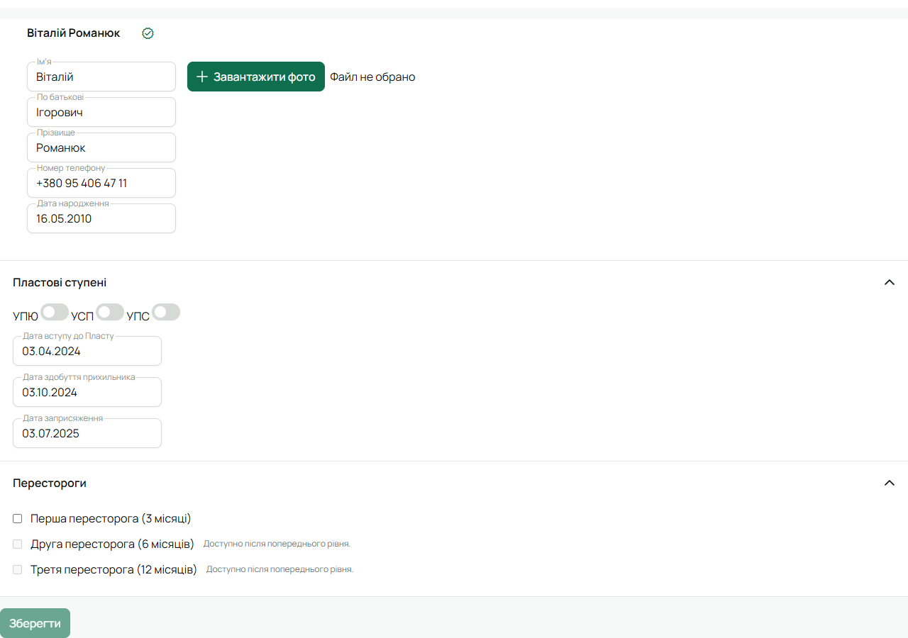

Пересторога — офіційне зауваження юнакові. Її виносить впорядник свого гуртка або Звʼязковий.
Юнак одразу отримує сповіщення «Пересторогу призначено».

## Рівні

| Рівень | Діє |
|---|---|
| Перша пересторога | 3 місяці |
| Друга пересторога | 6 місяців |
| Третя пересторога | 12 місяців |

Наступний рівень доступний лише тоді, коли діє попередній: другу не винести без першої. Біля
недоступного рівня стоїть підказка «Доступно після попереднього рівня».

## Кроки

1. Відкрий картку юнака і натисни **«Редагувати»**.
2. Внизу форми розгорни блок **«Перестороги»** (він є лише в наявної людини, не в новій формі).
3. Постав галочку біля рівня, який виносиш. Окремого поля для причини немає — поясни юнакові
   словами або запиши в нотатці на сходинах.
4. Натисни **«Зберегти»**.

На картці юнака біля імені зʼявляться три крапки: скільки з них зафарбовано — такий рівень діє.
Наведи на них, щоб побачити рівень і скільки днів лишилось.

## Скасувати

Скасувати пересторогу може лише той, хто її виніс: у тій самій формі зніми галочку і збережи.
Іншим поруч видно підказку «Скасувати може лише автор перестороги». Коли термін минає,
пересторога перестає діяти сама.

## На телефоні

Картка юнака → **«Редагувати»** → розділ **«Перестороги»** — ті самі три рівні.
