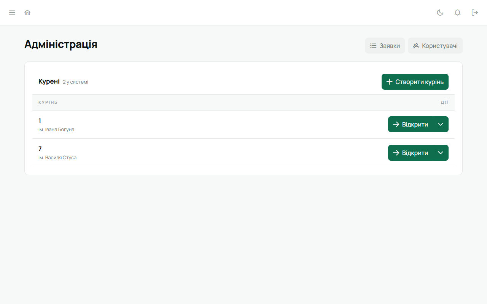
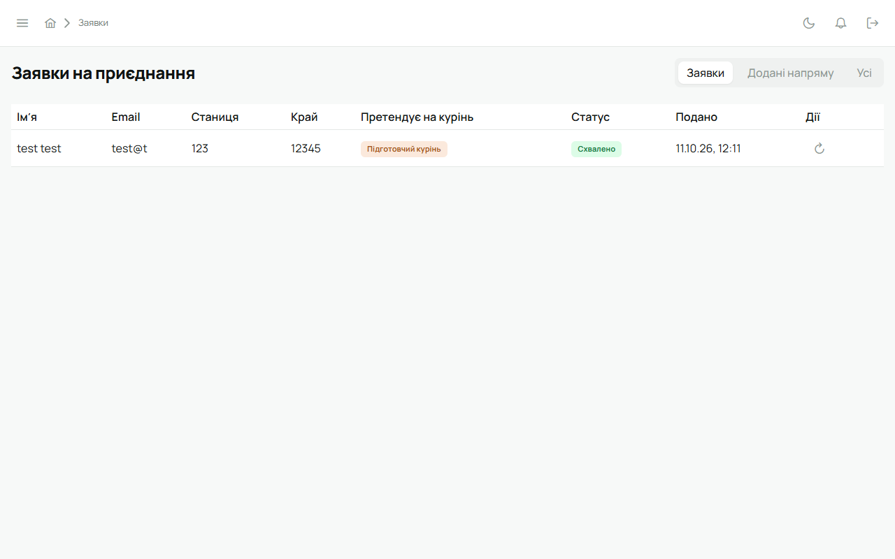
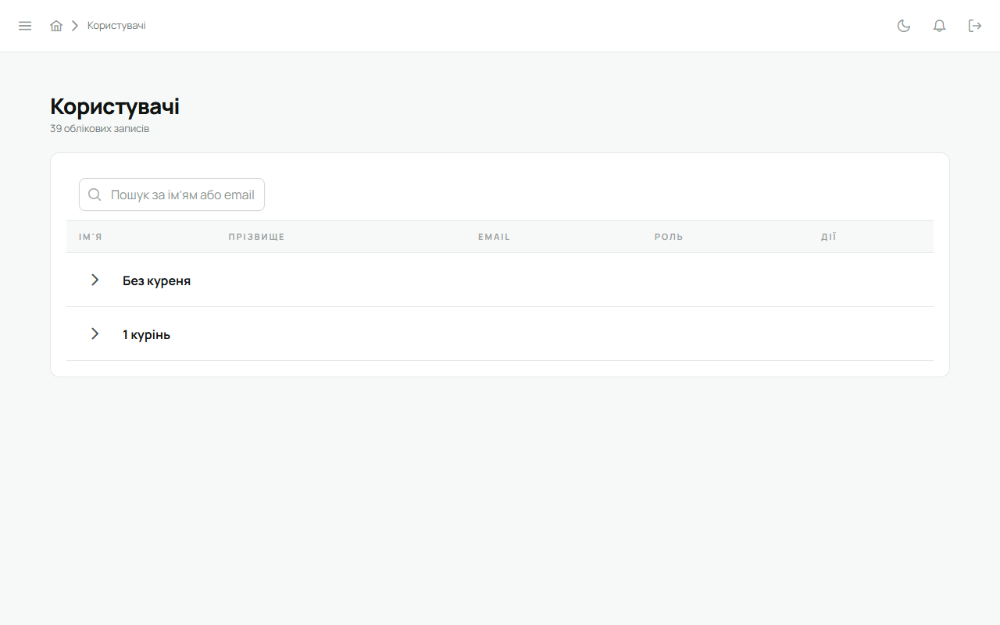
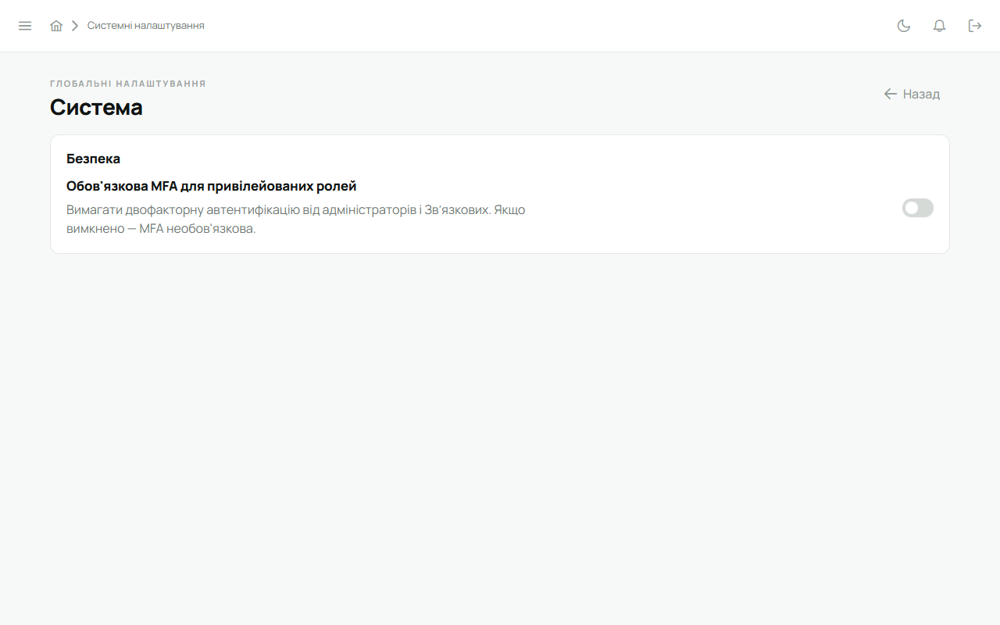

Адміністратор веде саму систему, а не курінь: відкриває нові курені, вирішує заявки на
приєднання, керує акаунтами. У кожному курені він може все, що й Звʼязковий, але сам не є
членом куреня.

Адміністратор має увімкнути [двофакторний вхід](/user/howto/enable-mfa/). Якщо на вашій
інсталяції це обовʼязково, Лілейка попросить налаштувати його одразу після входу.

:::tip[Свій робочий акаунт поруч]
Якщо ти водночас Звʼязковий чи впорядник у курені, тримай обидва акаунти на одному пристрої й
перемикайся між ними без пароля — див. [Перемкнути акаунт](/user/howto/switch-account/).
:::

## Адміністрація

Після входу адміністратор потрапляє на сторінку **«Адміністрація»** (вона ж — пункт бічного
меню). Тут список усіх куренів і кнопки **«Заявки»** та **«Користувачі»**.

- **«Відкрити»** — зайти в курінь і працювати в ньому як Звʼязковий. Повернутися — кнопка
  **«До адміністрації»** вгорі.
- Стрілка біля «Відкрити» → **«Редагувати»** (змінити число куреня) або **«Видалити»**.
- **«Створити курінь»** — новий курінь із числом. Зазвичай курені зʼявляються самі, коли
  адміністратор схвалює заявку Звʼязкового (нижче), тож створювати вручну доводиться рідко.
- Підготовчий курінь (ще без числа) показується як **«Підготовчий»** з іменем, на честь кого він.
  Детально — [Підготовчий курінь](/user/howto/preparatory-kurin/).

## Заявки на приєднання

Новий курінь приходить у Лілейку через заявку: Звʼязковий заповнює форму на сайті (`/join`), а
адміністратор її вирішує. Коли є заявка, що чекає рішення, біля пункту «Адміністрація» в бічному
меню світиться крапка.

1. **«Адміністрація»** → **«Заявки»**.
2. Вгорі — фільтр: **«Заявки»** (типово — те, що подали люди), **«Додані напряму»** (кого провід
   додав сам, без заявки) і **«Усі»**.
3. У рядку заявки:
   - ✓ **«Схвалити й надіслати запрошення»** — курінь одразу зʼявиться в списку (з числом із
     заявки або підготовчий), а Звʼязковому піде лист із посиланням для активації. Активувавши
     акаунт, він стає Звʼязковим цього куреня. Якщо курінь із таким числом уже є, схвалення не
     пройде: Лілейка скаже, що число зайняте;
   - ✗ **«Відхилити»** — можна вписати причину відмови. Відхилений може подати заявку знову з тією
     самою поштою;
   - ↻ **«Надіслати запрошення ще раз»** — для вже схвалених, якщо лист не дійшов.
4. Позначка **«Підготовчий курінь»** у колонці «Претендує на курінь» означає, що курінь ще без
   числа.

Статуси заявок: «Подано», «Потрібна перевірка», «Перевірено», «Схвалено», «Відхилено».

## Користувачі

**«Адміністрація»** → **«Користувачі»**: усі акаунти системи, згруповані за куренями, з пошуком за
імʼям або email.

У рядку користувача:

- **олівець** → змінити **роль**: «Адміністратор» або «Учасник». Ролі в курені (Звʼязковий,
  впорядник, провід) тут не змінюються — їх призначають у самому курені;
- **«Призупинити акаунт»** — людина більше не може увійти, її сесії на всіх пристроях закінчуються
  одразу. Дані лишаються. **«Поновити акаунт»** повертає вхід;
- **«Видалити користувача»** — прибрати акаунт.

## Система

Бічне меню → **«Системні налаштування»**. Тут один перемикач: **«Обовʼязкова MFA для привілейованих
ролей»** — вимагати двофакторний вхід від адміністраторів і Звʼязкових.

## На телефоні

У мобільній версії в «Меню» адміністратора є **«Заявки»** — їх можна вирішувати з телефона.
«Адміністрація», «Користувачі» й «Системні налаштування» відкривають веб.

## Власний сервер

Якщо Лілейку розгорнуто на сервері вашої станиці чи куреня, першого адміністратора створює майстер
налаштування при першому запуску — див. [Власний сервер](/user/self-host/).
