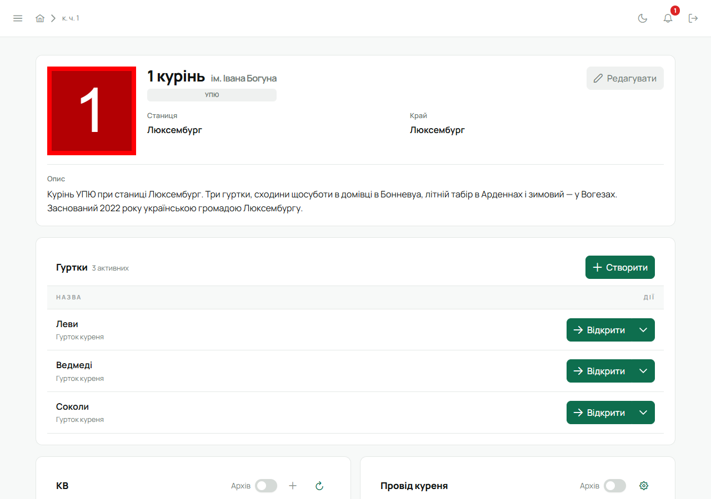
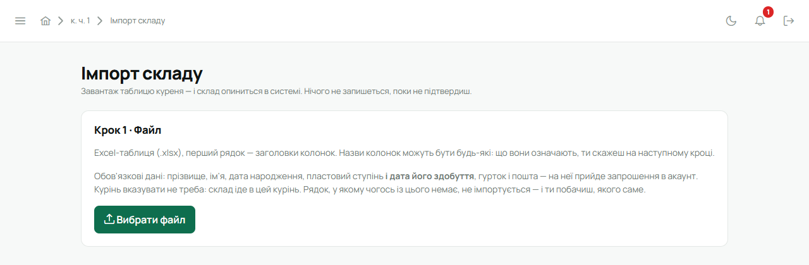
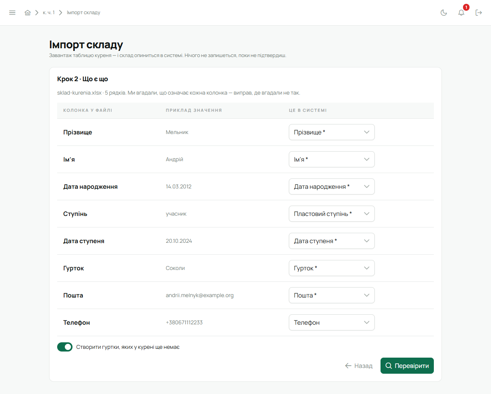
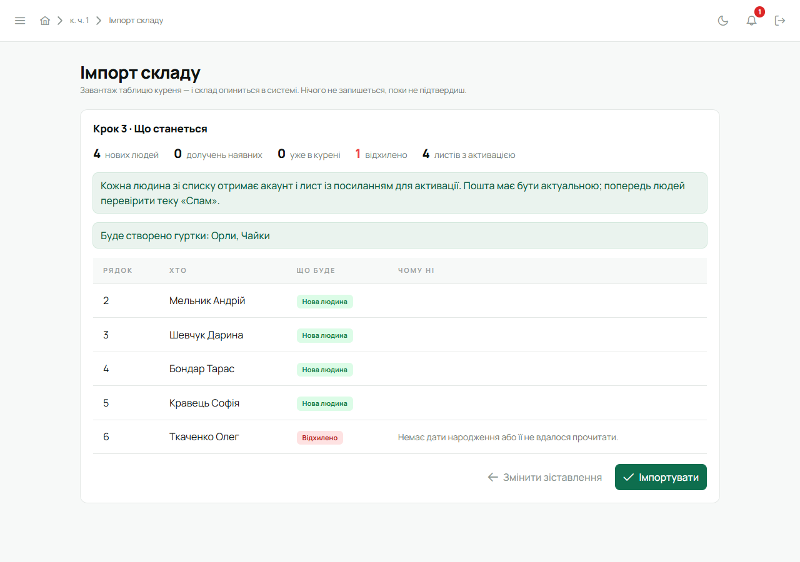
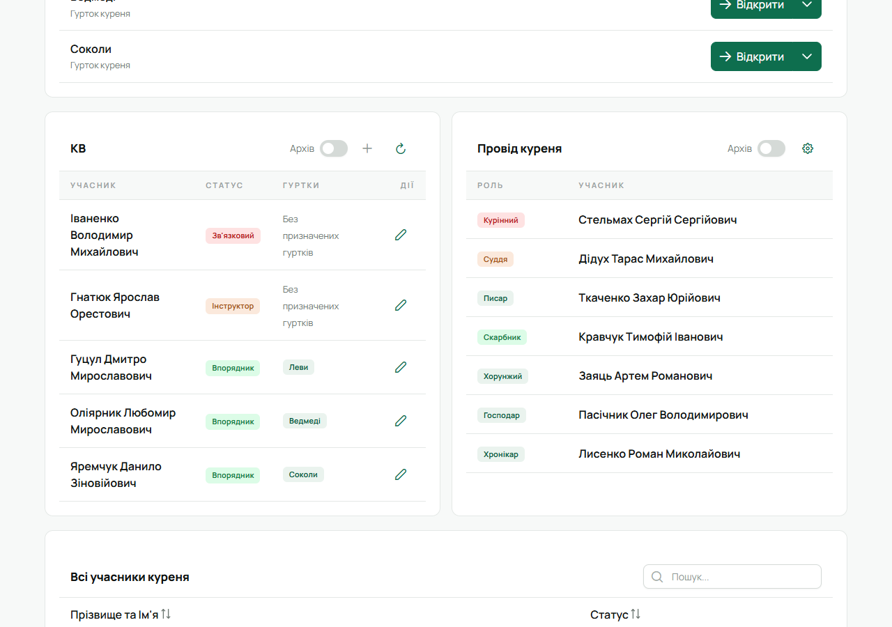
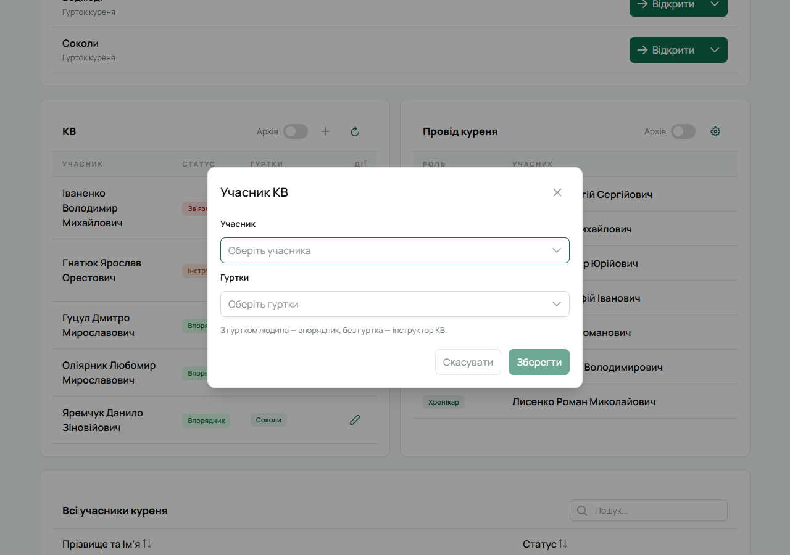
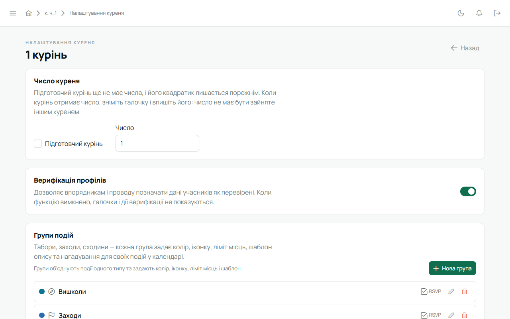
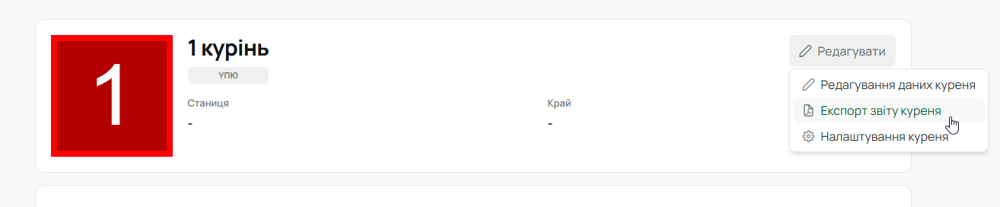

Звʼязковий бачить і веде весь курінь. Нижче — порядок дій від порожнього куреня до робочого.
Майже все тут робиться у вебі на компʼютері: реєстр, імпорт і налаштування куреня на телефоні
відкривають повну версію.

## 1. Сторінка «Курінь»

Бічне меню → **«Курінь»**. Тут дані куреня, гуртки, КВ, провід і всі учасники.

Кнопка **«Редагувати»** вгорі праворуч відкриває меню:

- **Редагування даних куреня** — чийого імені курінь, станиця, край, опис;
- **Експорт звіту куреня** — PDF (див. [нижче](#7-pdf-звіт));
- **Налаштування куреня** — див. [розділ 6](#6-налаштування-куреня).

## 2. Гуртки

У плитці **«Гуртки»** — **«Створити»** і назва гуртка. Опис гуртка додаєш на його сторінці. Стрілка біля
**«Відкрити»** в рядку гуртка — **«Редагувати»** чи **«Видалити»**. Якщо видалити гурток, його
люди лишаються в курені, просто без гуртка: перевести їх можна з картки
([Перевести, вивести, повернути](/user/howto/membership/#перевести-в-інший-гурток)).

Гуртки, яких ще немає, можна створити й під час імпорту.

## 3. Склад: імпорт із таблиці

Бічне меню → **«Імпорт складу»**. Нічого не запишеться, поки не підтвердиш.

**Крок 1 · Файл.** Excel-таблиця **.xlsx**, перший рядок — заголовки колонок, одна людина — один
рядок. Обовʼязкові: прізвище, імʼя, дата народження, пластовий ступінь **і дата його здобуття**,
гурток і пошта. Курінь вказувати не треба — склад іде в цей курінь.

**Крок 2 · Що є що.** Лілейка вгадує, яка колонка що означає. Виправ, де вгадала не так. Поки
обовʼязкове поле не вказане, «Перевірити» не натиснеш. Перемикач **«Створити гуртки, яких у
курені ще немає»** увімкнений: якщо його вимкнути, рядки з невідомим гуртком буде відхилено.

**Крок 3 · Що станеться.** Підсумок і кожен рядок окремо: **нова людина**, **долучення** того, хто
вже є в Лілейці (збіг за поштою чи телефоном), **уже в курені** або **відхилено** — і чому.
Натисни **«Імпортувати»**.

:::caution[Кожен рядок з поштою отримує акаунт]
Людям одразу підуть листи з посиланням для активації. Перевір, що пошта в таблиці актуальна, і
попередь людей зазирнути в теку «Спам». Не дійшов лист — [надішли ще раз](/user/howto/membership/#надіслати-запрошення-ще-раз).
:::

Відхилені рядки можна виправити у файлі й імпортувати ще раз: ті, хто вже заведені, не подвояться.

Одну людину руками — **«Додати учасника куреня»** під списком учасників на сторінці «Курінь» або
на сторінці гуртка. Перевести, вивести чи повернути колишнього —
[Перевести, вивести, повернути людину](/user/howto/membership/).

## 4. КВ і провід

**КВ** (кадра виховників) — плитка на сторінці «Курінь».

- **Додати до КВ** — «+» у плитці. Обери людину з акаунтом і гуртки, які вона вестиме. З гуртками
  вона **впорядник** — з правами на свої гуртки; без гуртка — **інструктор**.

  

- **Змінити гуртки** — олівець «Налаштувати гуртки» в рядку людини.
- **Передати роль звʼязкового** — стрілка-коло в плитці. Обрана людина стає Звʼязковим, а ти цю
  роль втрачаєш. У КВ ти лишишся впорядником, лише якщо за тобою закріплені гуртки — інакше
  попроси нового Звʼязкового додати тебе знову.
- **Архів** — хто колись був у КВ і коли.

**Провід куреня** — курінний, суддя, писар, скарбник та інші ролі — сусідня плитка, шестерня
**«Налаштувати провід»**. Покроково: [Записати провід куреня чи гуртка](/user/howto/assign-leadership/).

Права йдуть саме звідси: змінив КВ чи провід — права людини зміняться, щойно вона наступного разу
відкриє Лілейку. Хто що може — [Ролі та діловодства](/user/start/roles/).

## 5. Реєстр

Бічне меню → **«Реєстр»**: юнацтво і КВ окремо, ступені, пошук, вивантаження в таблицю, колишні
члени куреня. Детально — [Реєстр](/user/features/registry/).

## 6. Налаштування куреня

«Редагувати» → **«Налаштування куреня»**.

- **Число куреня** — для підготовчого куреня без числа; коли курінь його отримає, зніми галочку й
  впиши: [Підготовчий курінь](/user/howto/preparatory-kurin/).
- **Верифікація профілів** — чи можуть впорядники й провід позначати дані учасників як перевірені:
  [Верифікувати профіль](/user/howto/verify-profile/).
- **Групи подій** — табори, сходини, заходи з кольором, значком, шаблоном опису й лімітом місць:
  [Групи подій](/user/howto/event-groups/).
- **Архів задач** — коли зроблені задачі самі сходять з дошки в архів.

Натисни **«Зберегти»** внизу.

## 7. PDF-звіт

«Редагувати» → **«Експорт звіту куреня»**. У файлі склад, гуртки, КВ, провід, ступені, дата й
версія Лілейки. Для інституційної памʼяті: раз на пів року збережи файл — і курінь не залежить від
жодного сервісу.

## 8. Календар, задачі, планування

- **Календар і задачі** — ти бачиш і можеш змінювати все в курені: [Створити подію](/user/howto/create-event/),
  [Створити задачу](/user/howto/create-task/).
- **Планування** — підбір дати табору за зайнятістю КВ: [Планування](/user/features/planning/).

## 9. Вкладка і точкування

- **Вкладка.** Задай статті вкладки куреня (назва, кому йдуть гроші, сума й сума з пільгою) з
  кварталу, з якого курінь починає вести вкладку. Без них нарахувань немає. Каси всіх гуртків і курінна — у бічному
  меню, операції курінної каси позначаєш «Перевірено». Детально — [Вкладка](/user/features/dues/).
- **Точкування.** У «Налаштуваннях» таблиці обери, як рахувати бал гуртка, скільки балів дає
  присутність у кожній групі подій, правила автоматичних балів і перелік позицій. Приватна книга
  КВ — кнопка «Точкування КВ». Детально — [Точкування](/user/features/score/).
- **Справи.** На [головній](/user/features/dashboard/) усе, що чекає на тебе в курені, зібрано в
  одній плитці.

## 10. Безпека

Тобі обовʼязковий двофакторний вхід (якщо його вимагає сервер) — див. [Акаунт і безпека](/user/account/).
Резервні коди зберігай окремо від телефона.

## На телефоні

Вкладка **«Курінь»**: гуртки, КВ, провід, учасники, «Налаштувати провід».
Реєстр, імпорт і налаштування куреня з телефона відкривають повну версію в браузері.
Детально — [Лілейка на телефоні](/user/features/mobile-app/).
