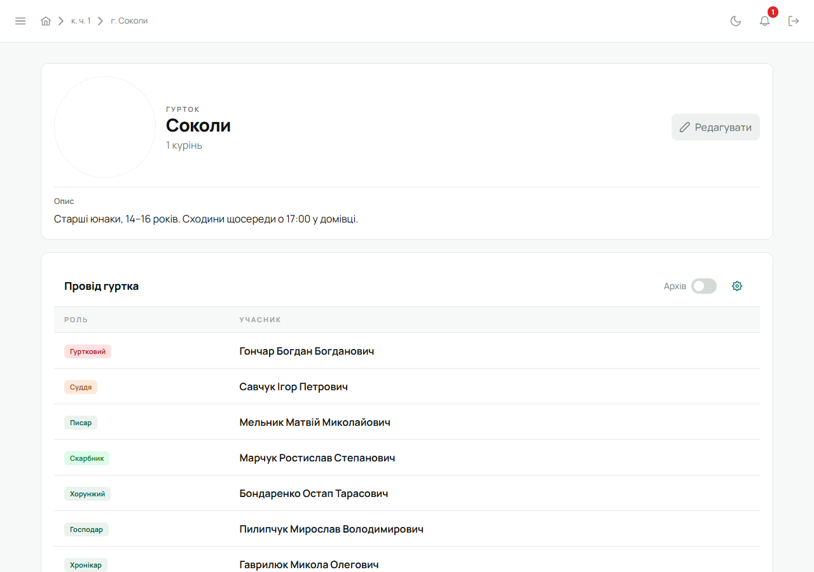

Ти заходиш у Лілейку за запрошенням від впорядника чи Звʼязкового: на пошту приходить лист, далі —
пароль і ти всередині. Покроково — [Перший вхід](/user/start/first-login/).

## Головна

Після входу відкривається [головна](/user/features/dashboard/): найближчі події з відповіддю
«Іду / Можливо / Не йду» прямо в рядку, твої задачі, проба з наступними точками, вмілості, твої
бали в точкуванні й місце гуртка, а ще вкладка — чи є борг. Плитки можна переставити й сховати.

## Мій профіль

У бічному меню є «Мій профіль» — твоя картка учасника. Тут:

- фото, ступінь, гурток і курінь;
- **проба** — які точки вже підписані, які ні; біля кожної — хто її підписав;
- **вмілості** — здобуті і ті, що на розгляді. Подати вмілість можеш сам, впорядник розгляне і
  підтвердить — [Вмілості й відзначення](/user/howto/skills-and-awards/);
- **відзначення УПЮ** — їх теж можна подати самому на розгляд впорядника; **перестороги**, якщо
  були, виносить впорядник чи Звʼязковий;
- **вкладка** — твій баланс.

Свою пошту й телефон змінюєш у [налаштуваннях акаунта](/user/account/).

## Вкладка і точкування

- **Вкладка** — на головній і на своїй картці видно свій баланс: «Сплачено», борг або надлишок,
  ставку за квартал і останні внески. Борг віддаєш скарбникові гуртка — [Вкладка](/user/features/dues/).
- **Точкування** — таблиця гуртків куреня в бічному меню, а свої бали й з чого вони склались — на
  головній — [Точкування](/user/features/score/).

## Календар і задачі

Календар куреня показує сходини, табори й заходи, які стосуються тебе, твого гуртка або всього
куреня. На подію можна відповісти «Іду», «Можливо» або «Не йду» — у сходин, що повторюються,
окремо на кожну дату.

У задачах видно те, що призначено тобі особисто чи твоєму гуртку. Задачу, яку гурток робить
«кожному окремо» (наприклад, здати вкладку), ти закриваєш за себе; ту, що «закриває провід», лише
бачиш — її закриє гуртковий. Детально — [Календар і задачі](/user/features/calendar-and-tasks/).

## Сповіщення

Дзвіночок угорі: коли впорядник розглянув вмілість, підтвердив відзначення, виніс пересторогу чи
призначив тобі подію або задачу — тут зʼявиться повідомлення з переходом на потрібну сторінку.
Про підписану точку проби сповіщення не приходить — її видно на сторінці проби.
Детально — [Сповіщення](/user/features/notifications/).

## Гуртковий провід

Якщо ти гуртковий, суддя, писар, скарбник чи господар гуртка — це записано в проводі гуртка
(плитка «Провід гуртка» на сторінці гуртка). Така роль дає права: скарбник веде касу гуртка, суддя —
точкування, гуртковий — і те, і інше, і задачі гуртка. Детально — [Ролі та діловодства](/user/start/roles/).

## На телефоні

Лілейку зручно тримати на телефоні: вкладки «Головна», «Календар», «Задачі», «Курінь» і «Меню». Свій
профіль — «Меню» → твоє імʼя вгорі. Там же — «Сповіщення на телефон», щоб отримувати їх
навіть із закритою Лілейкою. Як встановити — [Встановити Лілейку на телефон](/user/howto/install-app/),
що де — [Лілейка на телефоні](/user/features/mobile-app/).
