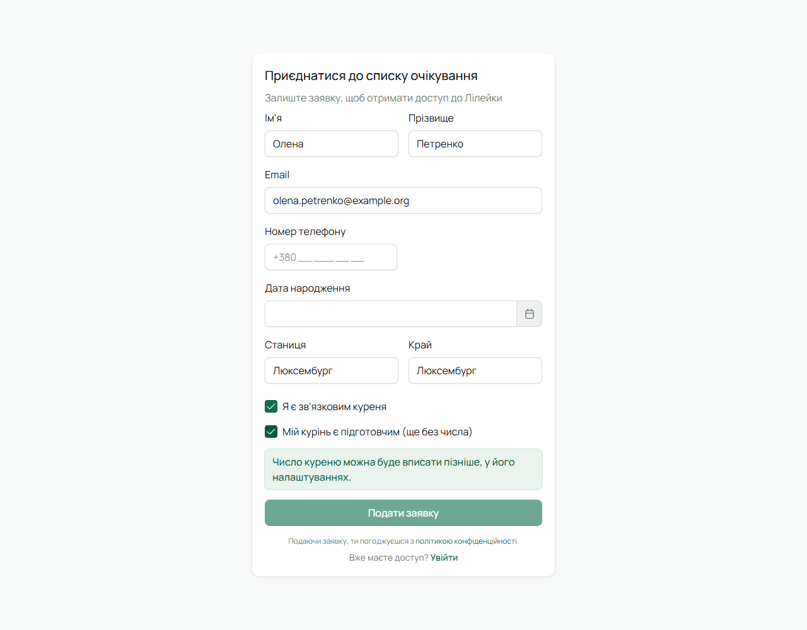
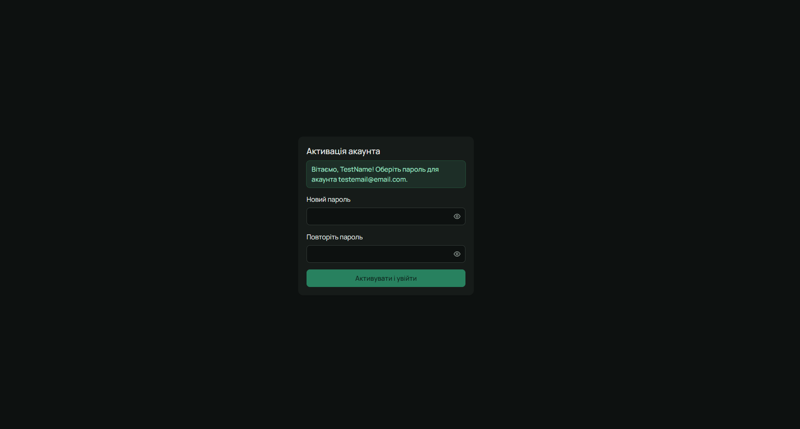
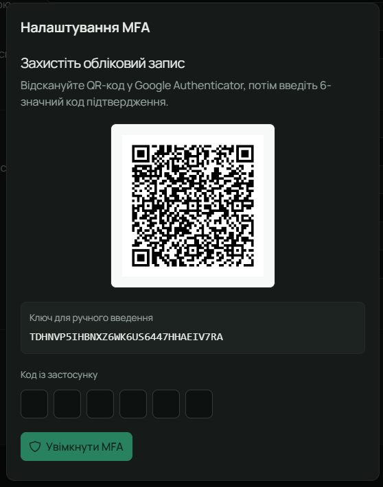
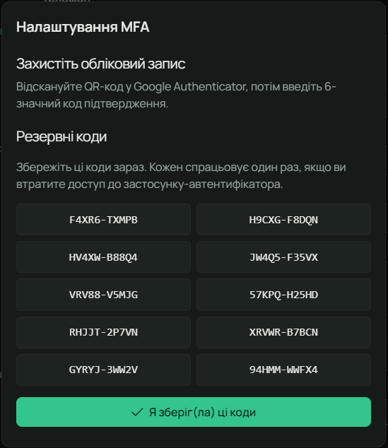

## 1. Заявка від куреня

Лілейка зараз приймає **курені**, не окремих пластунів. Заявку подає Звʼязковий на сторінці
«Приєднатися»:

1. Імʼя, прізвище, email, номер телефону, дата народження, станиця й край.
2. Позначка **«Я є зв'язковим куреня»** — і тоді **«Число куреня»**. Курінь ще без числа? Постав
   **«Мій курінь є підготовчим (ще без числа)»** — див. [Підготовчий курінь](/user/howto/preparatory-kurin/).
3. Згода з [політикою конфіденційності](/user/privacy/) і **«Подати заявку»**.

Після подачі приходить підтвердження на екрані. Далі заявку переглядає адміністратор системи, що
займе певний час.

## 2. Лист із запрошенням

Коли заявку схвалено, на вказану пошту приходить лист «Лілейка · запрошення до системи» із зеленою кнопкою «Активувати акаунт». Посилання діє 7 днів.

:::caution[Перевір «Спам»]
Листи від Лілейки іноді потрапляють у «Спам» чи «Промоакції». Якщо листа не видно — загляни туди
і додай відправника до контактів.
:::

Якщо посилання прострочилось, сторінка активації так і скаже й покаже кнопку **«Надіслати нове
запрошення»**. Те саме — на сторінці входу: «Забули пароль?» з тією самою адресою надішле нове
запрошення.

## 3. Пароль

За посиланням відкривається сторінка активації з твоїм імʼям і поштою. Впиши **«Новий пароль»** і
**«Повторіть пароль»**. Пароль має:

- щонайменше 8 символів;
- велику латинську літеру (A–Z);
- цифру;
- символ, як-от `! ? #` або `_`.

Під полем видно, які правила вже виконано. Натисни **«Активувати і увійти»** — і ти одразу в
системі, у своєму курені. Окремо заходити не треба.

## 4. Другий фактор для проводу

Звʼязковому й адміністратору система вимагає **двофакторний вхід** (MFA). При першому вході зʼявиться вікно з QR-кодом:

1. Встанови застосунок-автентифікатор - Google Authenticator.
2. Відскануй QR-код або введи ключ вручну.
3. Введи шестизначний код із застосунку.
4. **Збережи резервні коди** — кожен спрацьовує один раз, якщо телефон загубиться.

Далі при вході після пароля система спитає код. На тому самому пристрої вона запамʼятає тебе на **7 днів**: вихід і повторний вхід протягом тижня коду не вимагають. Новий пристрій — знову перевірка коду.

Юнаки та впорядники можуть увімкнути MFA за бажанням у [налаштуваннях акаунта](/user/account/).

:::tip[Як це зробити]
Крок за кроком: [Увімкнути двофакторний вхід](/user/howto/enable-mfa/).
:::
## 5. Лілейка на телефоні

Лист можна відкрити й на телефоні: активація працює так само, а після неї телефон сам перейде в
мобільну версію. Лілейку можна поставити на телефон як застосунок — без Play Market і App Store, з
іконкою на екрані й сповіщеннями: [Встановити Лілейку на телефон](/user/howto/install-app/).
